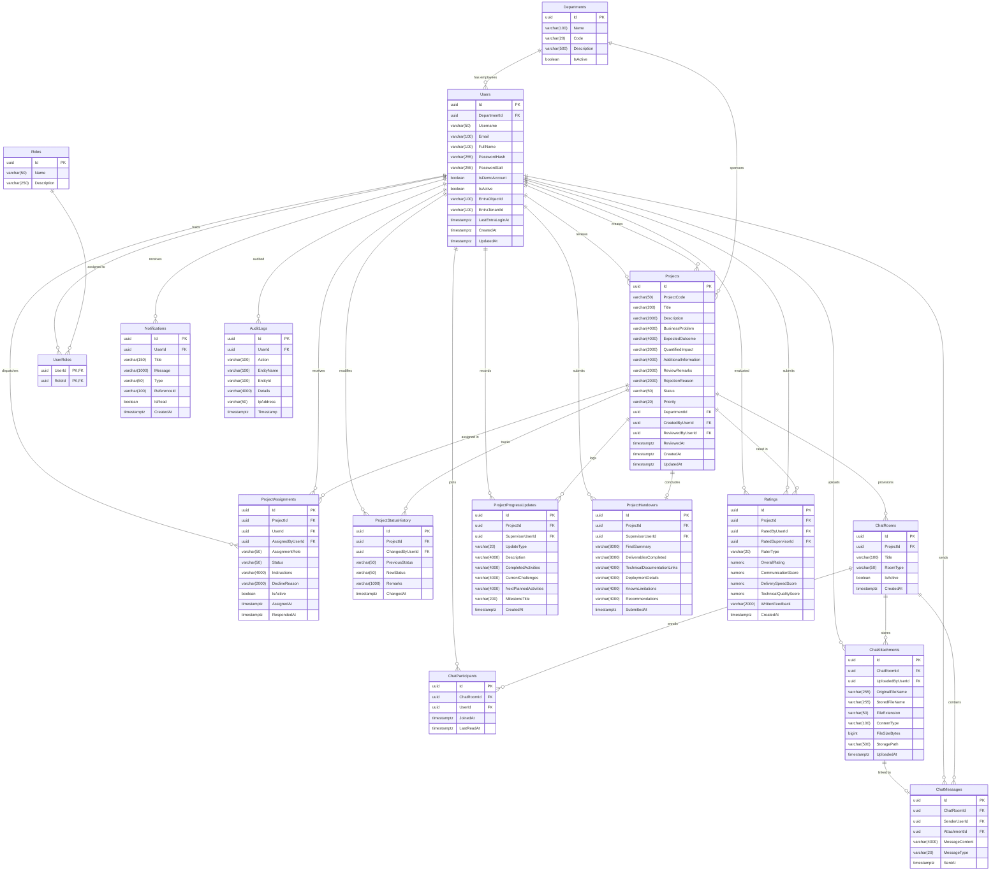

# SLT Inter-Departmental Project Communication & Collaboration System
## Document 3: Database Documentation

---

### Document Information
- **Document Reference:** SLT-DOC-2026-SYS-003
- **Document Title:** Database Specification & Data Dictionary
- **Classification:** CONFIDENTIAL &bull; INTERNAL HANDOVER
- **Version:** 1.0.0 (Production Candidate)
- **Prepared Date:** November 2026
- **Target Audience:** Database Administrators, Backend Engineers, DevOps Engineers, Security Auditors

---

# 1. Database Overview

The **SLT Inter-Departmental Project Communication & Collaboration System** utilizes **PostgreSQL 16** as its relational database management system. Persistence, schema migrations, and entity mapping are managed through **Entity Framework Core 8 Code-First**.

### Database Technical Profile
- **RDBMS Engine:** PostgreSQL 16.x
- **Database Name:** `slt_collab_db`
- **ORM Framework:** Entity Framework Core 8.0.11
- **Driver Provider:** `Npgsql.EntityFrameworkCore.PostgreSQL` 8.0.11
- **Default Collation:** `en_US.utf8`
- **Default Character Set:** `UTF8`
- **Primary Key Strategy:** Universally Unique Identifier (`uuid` / `Guid`), generated client-side via `Guid.NewGuid()` to avoid sequence lock contention.
- **Timestamp Strategy:** Coordinated Universal Time (`timestamp with time zone` / `DateTime.UtcNow`) across all audit and lifecycle records.

---

# 2. Entity Relationship Diagram (ERD)

The diagram below reflects the exact schema, relationships, and foreign key constraints implemented in `slt_collab_db`:

---

# 3. Data Dictionary

### 3.1 `Departments` Table
Stores organizational department units within Sri Lanka Telecom.

| Column | Type | Constraints | Description |
|---|---|---|---|
| `Id` | `uuid` | PK, NOT NULL | Unique department identifier |
| `Name` | `varchar(100)` | NOT NULL | Official department name |
| `Code` | `varchar(20)` | NOT NULL, UNIQUE | Unique department short code (e.g., `DL`, `NET`, `MKT`, `ENT`) |
| `Description`| `varchar(500)` | NULL | Optional functional description |
| `IsActive` | `boolean` | NOT NULL, DEFAULT true | Operational status flag |

**Indexes:**
- `PK_Departments`: Primary key on `Id`
- `IX_Departments_Code`: Unique index on `Code`
- `IX_Departments_Name`: Index on `Name`
- `IX_Departments_IsActive`: Index on `IsActive`

---

### 3.2 `Roles` Table
Stores authorization roles governing platform permissions.

| Column | Type | Constraints | Description |
|---|---|---|---|
| `Id` | `uuid` | PK, NOT NULL | Unique role identifier |
| `Name` | `varchar(50)` | NOT NULL, UNIQUE | Role name (`ADMIN`, `DGM`, `HIGHER_MANAGEMENT`, `DIGITAL_LAB_USER`, `NON_DIGITAL_LAB_USER`) |
| `Description`| `varchar(250)` | NULL | Functional role description |

**Indexes:**
- `PK_Roles`: Primary key on `Id`
- `IX_Roles_Name`: Unique index on `Name`

---

### 3.3 `Users` Table
Stores employee account records, authentication credentials, and Microsoft Entra mappings.

| Column | Type | Constraints | Description |
|---|---|---|---|
| `Id` | `uuid` | PK, NOT NULL | Unique employee identifier |
| `DepartmentId`| `uuid` | FK, NOT NULL | Associated department (`Departments.Id`) |
| `Username` | `varchar(50)` | NOT NULL, UNIQUE | Unique login username |
| `Email` | `varchar(100)` | NOT NULL, UNIQUE | Official corporate email address |
| `FullName` | `varchar(100)` | NOT NULL | Employee full legal name |
| `PasswordHash`| `varchar(255)`| NOT NULL | PBKDF2-SHA256 password hash |
| `PasswordSalt`| `varchar(255)`| NOT NULL | Cryptographic 32-byte salt (Base64) |
| `IsDemoAccount`| `boolean` | NOT NULL, DEFAULT false | Flag distinguishing pre-seeded demo accounts |
| `IsActive` | `boolean` | NOT NULL, DEFAULT true | Account status flag |
| `EntraObjectId`| `varchar(100)`| NULL | Microsoft Entra immutable user object ID (`oid`) |
| `EntraTenantId`| `varchar(100)`| NULL | Microsoft Entra directory tenant ID (`tid`) |
| `LastEntraLoginAt`| `timestamptz`| NULL | Timestamp of last successful Microsoft sign-in |
| `CreatedAt` | `timestamptz` | NOT NULL, DEFAULT now() | Account creation timestamp |
| `UpdatedAt` | `timestamptz` | NULL | Last account modification timestamp |

**Indexes:**
- `PK_Users`: Primary key on `Id`
- `IX_Users_Username`: Unique index on `Username`
- `IX_Users_Email`: Unique index on `Email`
- `IX_Users_DepartmentId`: Index on `DepartmentId`
- `IX_Users_IsActive`: Index on `IsActive`
- `IX_Users_IsDemoAccount`: Index on `IsDemoAccount`
- `IX_Users_EntraObjectId`: Partial unique index (`WHERE "EntraObjectId" IS NOT NULL`)
- `IX_Users_EntraTenantId_EntraObjectId`: Partial composite unique index (`WHERE "EntraTenantId" IS NOT NULL AND "EntraObjectId" IS NOT NULL`)

**Foreign Keys:**
- `FK_Users_Departments_DepartmentId`: References `Departments(Id)` with `ON DELETE RESTRICT`

---

### 3.4 `UserRoles` Table
Many-to-many join table mapping users to their assigned roles.

| Column | Type | Constraints | Description |
|---|---|---|---|
| `UserId` | `uuid` | PK, FK, NOT NULL | References `Users(Id)` |
| `RoleId` | `uuid` | PK, FK, NOT NULL | References `Roles(Id)` |

**Indexes:**
- `PK_UserRoles`: Composite primary key on `(UserId, RoleId)`
- `IX_UserRoles_RoleId`: Index on `RoleId`

---

### 3.5 `Projects` Table
Core entity tracking project proposals, review states, and delivery metadata.

| Column | Type | Constraints | Description |
|---|---|---|---|
| `Id` | `uuid` | PK, NOT NULL | Unique project identifier |
| `ProjectCode` | `varchar(50)` | NOT NULL, UNIQUE | Autogenerated code (e.g., `PROP-2026-0014`) |
| `Title` | `varchar(200)` | NOT NULL | Project title |
| `Description` | `varchar(2000)`| NOT NULL | High-level project summary |
| `BusinessProblem`| `varchar(4000)`| NULL | Detailed departmental operational problem |
| `ExpectedOutcome`| `varchar(4000)`| NULL | Desired technical / business outcome |
| `QuantifiedImpact`| `varchar(2000)`| NULL | Measurable KPI / financial benefit |
| `AdditionalInformation`| `varchar(4000)`| NULL | Technical constraints / reference links |
| `ReviewRemarks` | `varchar(2000)`| NULL | DGM evaluation notes |
| `RejectionReason`| `varchar(2000)`| NULL | Explicit rejection rationale |
| `Status` | `varchar(50)` | NOT NULL | Current lifecycle status |
| `Priority` | `varchar(20)` | NOT NULL, DEFAULT 'MEDIUM'| `LOW`, `MEDIUM`, `HIGH`, `CRITICAL` |
| `DepartmentId` | `uuid` | FK, NOT NULL | Sponsoring department |
| `CreatedByUserId`| `uuid` | FK, NOT NULL | Requester user ID |
| `ReviewedByUserId`| `uuid`| FK, NULL | DGM evaluator user ID |
| `ReviewedAt` | `timestamptz` | NULL | DGM review timestamp |
| `CreatedAt` | `timestamptz` | NOT NULL, DEFAULT now() | Submission timestamp |
| `UpdatedAt` | `timestamptz` | NULL | Last modification timestamp |

**Status Domain Values:**
`PENDING_REVIEW`, `APPROVED`, `REJECTED`, `ASSIGNED`, `DEVELOPMENT`, `TESTING`, `POC`, `VALIDATE`, `HANDOVER`, `COMPLETED`

**Indexes:**
- `PK_Projects`: Primary key on `Id`
- `IX_Projects_ProjectCode`: Unique index on `ProjectCode`
- `IX_Projects_Status`: Index on `Status`
- `IX_Projects_Priority`: Index on `Priority`
- `IX_Projects_DepartmentId`: Index on `DepartmentId`
- `IX_Projects_CreatedByUserId`: Index on `CreatedByUserId`
- `IX_Projects_CreatedAt`: Index on `CreatedAt`

---

### 3.6 `ProjectAssignments` Table
Tracks supervisor assignment dispatch, instructions, and acceptance state.

| Column | Type | Constraints | Description |
|---|---|---|---|
| `Id` | `uuid` | PK, NOT NULL | Unique assignment identifier |
| `ProjectId` | `uuid` | FK, NOT NULL | References `Projects(Id)` |
| `UserId` | `uuid` | FK, NOT NULL | Assigned Digital Lab supervisor (`Users(Id)`) |
| `AssignedByUserId`| `uuid`| FK, NOT NULL | DGM who dispatched assignment |
| `AssignmentRole`| `varchar(50)` | NOT NULL | Technical role (e.g., `Lead Supervisor`) |
| `Status` | `varchar(50)` | NOT NULL | `PENDING_ACCEPTANCE`, `ACCEPTED`, `DECLINED`, `CANCELLED` |
| `Instructions` | `varchar(4000)`| NULL | Specific DGM guidance & deadlines |
| `DeclineReason` | `varchar(2000)`| NULL | Mandatory supervisor decline justification |
| `IsActive` | `boolean` | NOT NULL, DEFAULT true | Active assignment flag |
| `AssignedAt` | `timestamptz` | NOT NULL, DEFAULT now() | Dispatch timestamp |
| `RespondedAt` | `timestamptz` | NULL | Acceptance / decline timestamp |

---

### 3.7 `ProjectStatusHistory` Table
Immutable chronological ledger recording all project state transitions.

| Column | Type | Constraints | Description |
|---|---|---|---|
| `Id` | `uuid` | PK, NOT NULL | Unique history entry identifier |
| `ProjectId` | `uuid` | FK, NOT NULL | Associated project |
| `ChangedByUserId`| `uuid`| FK, NOT NULL | User who initiated transition |
| `PreviousStatus`| `varchar(50)` | NULL | Status prior to transition |
| `NewStatus` | `varchar(50)` | NOT NULL | Status after transition |
| `Remarks` | `varchar(1000)`| NULL | Optional transition explanation |
| `ChangedAt` | `timestamptz` | NOT NULL, DEFAULT now() | Transition timestamp |

---

### 3.8 `ChatRooms` & `ChatParticipants` Tables
Manages collaboration spaces and participant permissions.

#### `ChatRooms`
| Column | Type | Constraints | Description |
|---|---|---|---|
| `Id` | `uuid` | PK, NOT NULL | Unique room identifier |
| `ProjectId` | `uuid` | FK, NULL | Associated project (NULL for general rooms) |
| `Title` | `varchar(100)` | NOT NULL | Channel title (e.g., `PROP-2026-0014 - Title`) |
| `RoomType` | `varchar(50)` | NOT NULL | `PROJECT_CHANNEL`, `DIRECT`, `DEPARTMENT` |
| `IsActive` | `boolean` | NOT NULL, DEFAULT true | Channel status flag |
| `CreatedAt` | `timestamptz` | NOT NULL, DEFAULT now() | Channel creation timestamp |

#### `ChatParticipants`
| Column | Type | Constraints | Description |
|---|---|---|---|
| `Id` | `uuid` | PK, NOT NULL | Unique participant membership record |
| `ChatRoomId` | `uuid` | FK, NOT NULL | Associated chat room |
| `UserId` | `uuid` | FK, NOT NULL | Enrolled employee |
| `JoinedAt` | `timestamptz` | NOT NULL, DEFAULT now() | Enrollment timestamp |
| `LastReadAt` | `timestamptz` | NULL | Read receipt timestamp |

**Indexes:**
- `IX_ChatParticipants_ChatRoomId_UserId`: Unique composite index preventing duplicate participant enrollment.

---

### 3.9 `ChatMessages` & `ChatAttachments` Tables
Persists real-time communication messages and uploaded document metadata.

#### `ChatMessages`
| Column | Type | Constraints | Description |
|---|---|---|---|
| `Id` | `uuid` | PK, NOT NULL | Unique message identifier |
| `ChatRoomId` | `uuid` | FK, NOT NULL | Target collaboration channel |
| `SenderUserId`| `uuid` | FK, NOT NULL | Message author |
| `AttachmentId`| `uuid` | FK, NULL | Optional associated document |
| `MessageContent`| `varchar(4000)`| NOT NULL | Message text or attachment descriptor |
| `MessageType` | `varchar(20)` | NOT NULL | `TEXT`, `ATTACHMENT`, `SYSTEM_NOTICE` |
| `SentAt` | `timestamptz` | NOT NULL, DEFAULT now() | Message dispatch timestamp |

#### `ChatAttachments`
| Column | Type | Constraints | Description |
|---|---|---|---|
| `Id` | `uuid` | PK, NOT NULL | Unique attachment identifier |
| `ChatRoomId` | `uuid` | FK, NOT NULL | Associated room |
| `UploadedByUserId`| `uuid`| FK, NOT NULL | Uploading participant |
| `OriginalFileName`| `varchar(255)`| NOT NULL | Client-side file name (e.g., `Spec.pdf`) |
| `StoredFileName` | `varchar(255)`| NOT NULL | Server-side GUID name (`{guid}.pdf`) |
| `FileExtension` | `varchar(50)` | NOT NULL | Normalized extension (`.pdf`, `.docx`) |
| `ContentType` | `varchar(100)`| NOT NULL | Validated MIME type (`application/pdf`) |
| `FileSizeBytes` | `bigint` | NOT NULL | Exact file payload size in bytes |
| `StoragePath` | `varchar(500)`| NOT NULL | Absolute / relative sandbox path |
| `UploadedAt` | `timestamptz` | NOT NULL, DEFAULT now() | Upload timestamp |

---

### 3.10 `ProjectProgressUpdates` & `ProjectHandovers` Tables
Captures supervisor development milestones and final handover deliverables.

#### `ProjectProgressUpdates`
| Column | Type | Constraints | Description |
|---|---|---|---|
| `Id` | `uuid` | PK, NOT NULL | Unique progress update record |
| `ProjectId` | `uuid` | FK, NOT NULL | Associated project |
| `SupervisorUserId`| `uuid`| FK, NOT NULL | Logging supervisor |
| `UpdateType` | `varchar(20)` | NOT NULL | `WEEKLY`, `MILESTONE`, `CRITICAL_ISSUE` |
| `Description` | `varchar(4000)`| NOT NULL | Technical summary |
| `CompletedActivities`| `varchar(4000)`| NULL | Bulleted completed tasks |
| `CurrentChallenges`| `varchar(4000)`| NULL | Blockers / dependency challenges |
| `NextPlannedActivities`| `varchar(4000)`| NULL | Upcoming sprint tasks |
| `MilestoneTitle`| `varchar(200)`| NULL | Optional milestone achievement name |
| `CreatedAt` | `timestamptz` | NOT NULL, DEFAULT now() | Update timestamp |

#### `ProjectHandovers`
| Column | Type | Constraints | Description |
|---|---|---|---|
| `Id` | `uuid` | PK, NOT NULL | Unique handover record |
| `ProjectId` | `uuid` | FK, NOT NULL, UNIQUE | Associated project (1:1 constraint) |
| `SupervisorUserId`| `uuid`| FK, NOT NULL | Submitting supervisor |
| `FinalSummary` | `varchar(8000)`| NOT NULL | Executive summary of delivered system |
| `DeliverablesCompleted`| `varchar(8000)`| NOT NULL | Inventory of delivered code & artifacts |
| `TechnicalDocumentationLinks`| `varchar(4000)`| NULL | URLs to Git repositories / docs |
| `DeploymentDetails`| `varchar(4000)`| NULL | Production server / container configuration |
| `KnownLimitations`| `varchar(4000)`| NULL | Known constraints or future scope items |
| `Recommendations`| `varchar(4000)`| NULL | Operational maintenance guidance |
| `SubmittedAt` | `timestamptz` | NOT NULL, DEFAULT now() | Formal handover timestamp |

---

### 3.11 `Ratings` Table
Stores multi-dimensional performance feedback.

| Column | Type | Constraints | Description |
|---|---|---|---|
| `Id` | `uuid` | PK, NOT NULL | Unique rating record |
| `ProjectId` | `uuid` | FK, NOT NULL | Evaluated project |
| `RatedByUserId`| `uuid` | FK, NOT NULL | Evaluator (`DGM` or `REQUESTER`) |
| `RatedSupervisorId`| `uuid`| FK, NOT NULL | Evaluated supervisor |
| `RaterType` | `varchar(20)` | NOT NULL | `DGM` or `REQUESTER` |
| `OverallRating`| `numeric` | NOT NULL | Overall 1.0 - 5.0 score |
| `CommunicationScore`| `numeric`| NOT NULL | 1.0 - 5.0 responsiveness score |
| `DeliverySpeedScore`| `numeric`| NOT NULL | 1.0 - 5.0 timeline velocity score |
| `TechnicalQualityScore`| `numeric`| NOT NULL | 1.0 - 5.0 technical excellence score |
| `WrittenFeedback`| `varchar(2000)`| NULL | Qualitative feedback text |
| `CreatedAt` | `timestamptz` | NOT NULL, DEFAULT now() | Evaluation submission timestamp |

**Indexes:**
- `IX_Ratings_ProjectId_RatedByUserId`: Unique composite index enforcing a strict limit of one rating per rater per project.

---

### 3.12 `Notifications` & `AuditLogs` Tables

#### `Notifications`
| Column | Type | Constraints | Description |
|---|---|---|---|
| `Id` | `uuid` | PK, NOT NULL | Unique notification identifier |
| `UserId` | `uuid` | FK, NOT NULL | Target recipient |
| `Title` | `varchar(150)` | NOT NULL | Notification headline |
| `Message` | `varchar(1000)`| NOT NULL | Detailed notification body |
| `Type` | `varchar(50)` | NOT NULL | `PROPOSAL`, `ASSIGNMENT`, `CHAT`, `MILESTONE` |
| `ReferenceId` | `varchar(100)` | NULL | Associated entity ID for deep linking |
| `IsRead` | `boolean` | NOT NULL, DEFAULT false | Read indicator |
| `CreatedAt` | `timestamptz` | NOT NULL, DEFAULT now() | Notification timestamp |

#### `AuditLogs`
| Column | Type | Constraints | Description |
|---|---|---|---|
| `Id` | `uuid` | PK, NOT NULL | Unique audit entry identifier |
| `UserId` | `uuid` | FK, NULL | Initiator user (NULL for failed login attempts) |
| `Action` | `varchar(100)` | NOT NULL | Event name (e.g., `ENTRA_LOGIN_SUCCESS`) |
| `EntityName` | `varchar(100)` | NOT NULL | Target entity type (e.g., `User`, `Project`) |
| `EntityId` | `varchar(100)` | NULL | Target entity ID |
| `Details` | `varchar(4000)`| NULL | Diagnostic event description |
| `IpAddress` | `varchar(50)` | NULL | Client IP address |
| `Timestamp` | `timestamptz` | NOT NULL, DEFAULT now() | UTC event timestamp |

---

# 4. EF Core Migration History

The database has been evolved through four formal EF Core Code-First migrations recorded in `__EFMigrationsHistory`:

| Migration ID | Applied Date | Changes Introduced |
|---|---|---|
| `20261111..._InitialCreate` | Initial Setup | Base schema: Users, Roles, UserRoles, Departments, Projects, ProjectAssignments, StatusHistory, ChatRooms, ChatParticipants, ChatMessages, ProgressUpdates, Handovers, Ratings, Notifications, AuditLogs. |
| `20261117..._AddChatAttachments` | Phase 12 | Added `ChatAttachments` table, configured foreign keys to `ChatRooms` and `ChatMessages`, and added attachment audit actions. |
| `20261118063103_AddMicrosoftEntraIdentity` | Phase 13 | Added `EntraObjectId`, `EntraTenantId`, and `LastEntraLoginAt` to `Users` table; added initial non-unique index `IX_Users_EntraObjectId`. |
| `20261118075213_AddEntraIdentityUniqueConstraints`| Phase 14 | Dropped non-unique index. Created partial unique index on `EntraObjectId` and partial composite unique index on `(EntraTenantId, EntraObjectId)` to prevent duplicate identity bindings. |

---

*End of Document 3: Database Documentation.*
