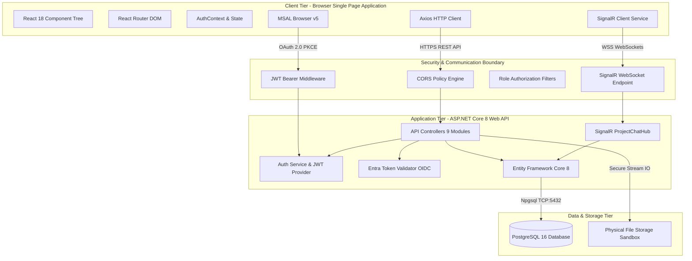
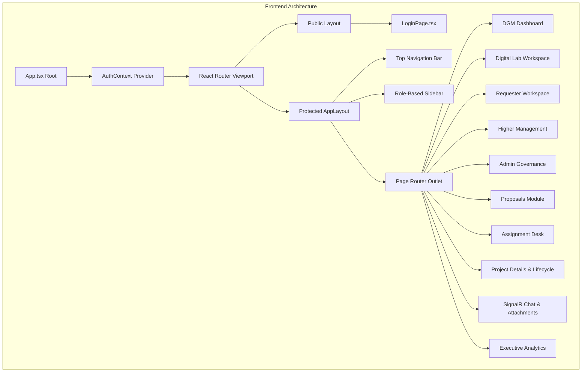
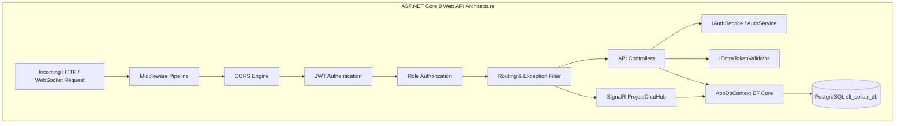
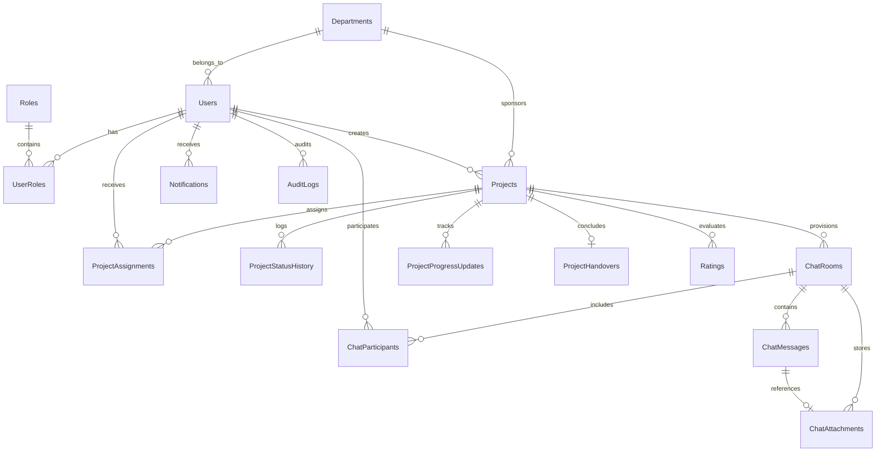
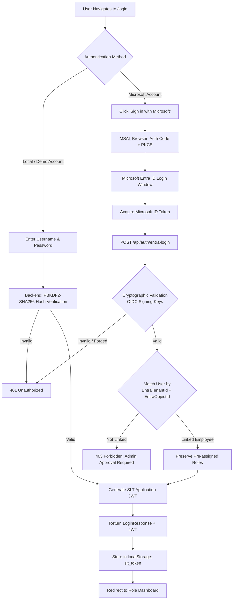
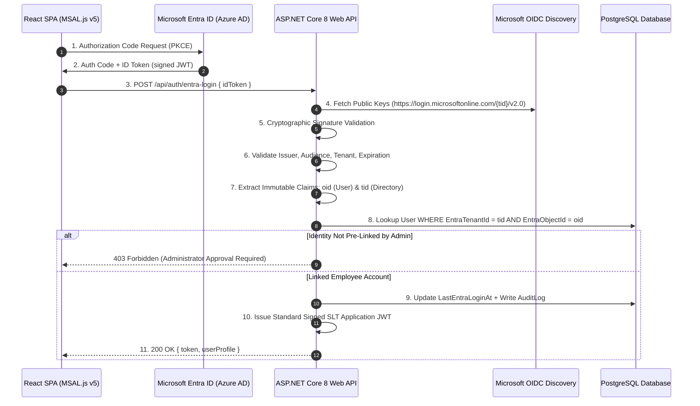
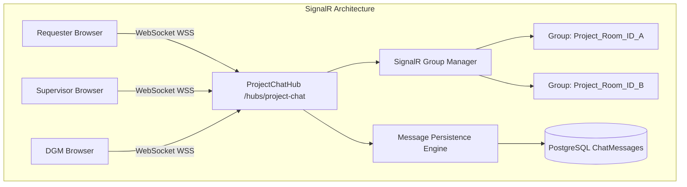
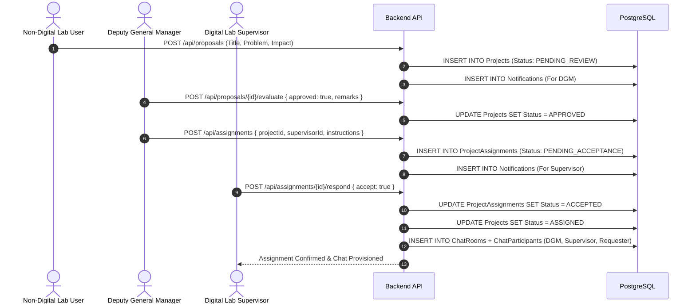
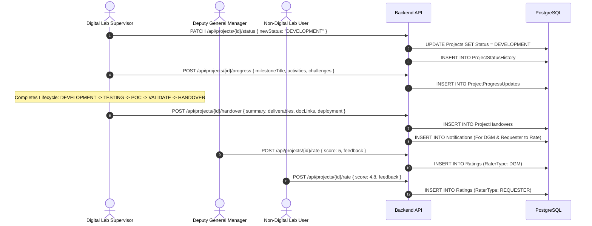

# SLT Inter-Departmental Project Communication & Collaboration System
## Document 2: System Architecture

---

### Document Information
- **Document Reference:** SLT-DOC-2026-SYS-002
- **Document Title:** System Architecture Specification
- **Classification:** CONFIDENTIAL &bull; INTERNAL HANDOVER
- **Version:** 1.0.0 (Production Candidate)
- **Prepared Date:** November 2026
- **Target Audience:** Software Architects, Lead Engineers, DevOps Administrators, Technical Supervisors

---

# 1. Architectural Overview

The **SLT Inter-Departmental Project Communication & Collaboration System** is designed using a modern, multi-tiered enterprise architecture that cleanly separates presentation, business logic, real-time messaging, and persistent storage.

The platform follows a **Client-Server Single Page Application (SPA)** architecture, integrating a decoupled React 18 frontend with an ASP.NET Core 8 Web API backend and a PostgreSQL 16 relational database.



---

# 2. Frontend Architecture

The frontend is implemented as an optimized, responsive Single Page Application (SPA) built with React 18, TypeScript, and Vite.



### 2.1 Component Structure & Layout Hierarchy
- **`App.tsx`:** Application root configuring the React Context providers, router boundaries, and authentication state listener.
- **`AuthContext.tsx`:** Manages global identity state (`user`, `token`, `isAuthenticated`, `roles`), session persistence via `localStorage`, and handles token synchronization across application tabs.
- **`AppLayout.tsx`:** Provides the authenticated shell featuring the SLT Corporate Top Navigation (notifications bell, profile menu, system status indicator) and dynamic Sidebar adjusted to the authenticated user's assigned role.
- **`LoginPage.tsx`:** Unified corporate sign-in interface offering both local/demo credential quick-fill and the official "Sign in with Microsoft" button.

### 2.2 Client-Side Services & Utilities
- **`api.ts` (Axios Client):** Centralized HTTP client configured with a request interceptor that automatically injects the `Authorization: Bearer <token>` header into outgoing calls. Handles response error normalization (401 triggers session eviction and redirect to `/login`).
- **`signalr.ts`:** Manages the lifecycle of the SignalR WebSocket connection to `/hubs/project-chat`, with automatic reconnection policies (`withAutomaticReconnect`), group subscription, and event handler registration.
- **`msalConfig.ts`:** Implements Microsoft Authentication Library (MSAL) Browser v5 configuration using Authorization Code Flow with PKCE, session cache storage, and tenant authority resolution.

---

# 3. ASP.NET Core Backend Architecture

The backend is built on ASP.NET Core 8 (.NET 8 LTS) utilizing C# 12. It follows the **Controller-Service-Repository** pattern with clean separation of concerns.



### 3.1 Controller Inventory
The API exposes 9 specialized controllers:

1. **`AuthController` (`/api/auth`):** Local login, Microsoft Entra login, Entra public config discovery, profile retrieval (`/me`), logout, admin identity linking/unlinking, and RBAC test endpoints.
2. **`ProposalsController` (`/api/proposals`):** Proposal creation, requester proposal queries (`/my`), all proposals list for DGM/Management, proposal detail lookup, and DGM evaluation (approve/reject).
3. **`AssignmentsController` (`/api/assignments`):** Unassigned project queries, supervisor workload listing, assignment dispatch, supervisor personal assignment feed (`/my`), and supervisor response handling (accept/decline).
4. **`ProjectsController` (`/api/projects`):** Project directory, status transitions (`/status`), progress update and milestone logging (`/progress`), formal handover (`/handover`), and performance rating submission (`/rate`).
5. **`ChatController` (`/api/chat`):** Room queries, message history, message posting, read receipts, and file attachment upload, download, and safe inline viewing.
6. **`DashboardController` (`/api/dashboard`):** Role-tailored operational KPIs and aggregate metrics for Admin, DGM, Higher Management, Digital Lab, and Non-Digital Lab users.
7. **`NotificationsController` (`/api/notifications`):** User notification stream, single mark-as-read, and bulk mark-all-read.
8. **`HealthController` (`/api/health`):** Comprehensive service liveness and PostgreSQL database connectivity probe.
9. **`DatabaseTestController` (`/api/databasetest`):** Diagnostic verification endpoint for internal development testing.

### 3.2 Services & Dependency Injection Container
- **`IAuthService` / `AuthService` (Scoped):** Manages PBKDF2 password verification, standard application JWT issuance, profile assembly, and admin-approved Entra identity binding.
- **`IEntraTokenValidator` / `EntraTokenValidator` (Singleton):** Manages OpenID Connect metadata caching (`ConfigurationManager<OpenIdConnectConfiguration>`), Microsoft public signing key rotation, and cryptographic token verification.
- **`AppDbContext` (Scoped):** EF Core database context configuring PostgreSQL connection pooling, entity mappings, cascades, and filtered unique indexes.

---

# 4. PostgreSQL Database Architecture

The persistence layer uses PostgreSQL 16 managed via Entity Framework Core 8 Code-First migrations.



### Key Database Architectural Features
- **UUID Primary Keys:** All entity primary keys use 128-bit Universally Unique Identifiers (`Guid` / `uuid`), preventing enumeration attacks.
- **Foreign Key Integrity:** Explicit `OnDelete(DeleteBehavior.Restrict)` on structural references (departments, users) and `OnDelete(DeleteBehavior.Cascade)` on transient child items (assignment records, chat messages).
- **Filtered Unique Indexes:** Partial indexes on `Users` ensure uniqueness for Microsoft Entra credentials (`EntraObjectId`, `(EntraTenantId, EntraObjectId)`) without blocking multiple NULL values for local accounts.
- **Transactional Consistency:** Critical state transitions (assignment acceptance triggering project status update and chat room provisioning) execute inside explicit database transactions.

---

# 5. Authentication Architecture

The system implements a dual-mode authentication architecture:



### 5.1 Local PBKDF2 Password Authentication
- Utilizes `Rfc2898DeriveBytes.Pbkdf2` with HMAC-SHA256.
- Configuration: 100,000 iterations, 32-byte salt, 32-byte subkey.
- Constant-time hash comparison via `CryptographicOperations.FixedTimeEquals` to prevent timing attacks.

### 5.2 Application JWT Token Specifications
- **Signing Algorithm:** HMAC-SHA256 (`HmacSha256`)
- **Key Length:** 256-bit symmetric security key
- **Expiration:** 480 minutes (8 hours)
- **Token Claims:**
  - `sub`: User GUID
  - `jti`: Unique Token Identifier GUID
  - `nameid`: User GUID
  - `name`: Username
  - `email`: Official Email Address
  - `fullName`: Full Employee Name
  - `departmentCode`: Sponsoring Department Code
  - `role`: Role claim repeated per assigned user role

---

# 6. Microsoft Entra ID Integration Architecture

The Microsoft Entra ID integration follows the official Microsoft identity recommendations:



### 6.1 Cryptographic Validation Pipeline
- Validates the token's signature using RSA public keys fetched from Microsoft's OpenID Connect discovery metadata.
- Validates issuer against both v2.0 (`https://login.microsoftonline.com/{tenantId}/v2.0`) and STS endpoints.
- Validates token audience against the application's registered Client ID.
- Rejects unverified, unsigned, forged, or expired tokens with `401 Unauthorized`.

### 6.2 Account Mapping & Non-Elevation Guarantee
- Identity is mapped using the immutable combination of Microsoft `oid` (Object ID) and `tid` (Tenant ID).
- Silent auto-linking by email claim is prohibited to prevent account hijacking.
- Pre-assigned application roles (`ADMIN`, `DGM`, `HIGHER_MANAGEMENT`, `DIGITAL_LAB_USER`, `NON_DIGITAL_LAB_USER`) are strictly preserved. Microsoft authentication never auto-provisions or escalates privileges.

---

# 7. SignalR Real-Time Communication Architecture

Real-time messaging is powered by ASP.NET Core SignalR over WebSockets.



### 7.1 Connection Lifecycle & Group Isolation
- **Endpoint:** `/hubs/project-chat`
- **Negotiation:** Uses WebSocket protocol with automatic fallback to Server-Sent Events (SSE) or Long Polling.
- **Authentication:** JWT access token passed via query parameter (`access_token`) during handshake and validated via `OnMessageReceived` event.
- **Group Isolation:** Clients join room-specific groups (`AddToGroupAsync`) only after room participant verification in PostgreSQL. Cross-room message leakage is structurally impossible.

### 7.2 Hub Protocol Methods
- **Client Invocations:**
  - `JoinRoom(Guid roomId)`: Enrolls connection into room group after permission verification.
  - `LeaveRoom(Guid roomId)`: Unenrolls connection from group.
  - `SendMessage(Guid roomId, string content, string messageType)`: Persists message in database and broadcasts to room group.
- **Server Events:**
  - `ReceiveMessage`: Dispatches new message DTO to group members.
  - `ReceiveAttachment`: Alerts participants of newly uploaded documents.
  - `UserJoined` / `UserLeft`: Real-time presence indicators.

---

# 8. File Upload & Storage Architecture

The file attachment subsystem enables secure project document exchange:

```mermaid
flowchart TD
    User[User Selects File in Chat] --> ClientCheck{Client-side Check<br/>Size <= 10MB & Allowed Ext?}
    ClientCheck -- No --> RejectClient[Show Error Banner]
    ClientCheck -- Yes --> Upload[POST /api/chat/rooms/{roomId}/attachments]

    Upload --> AuthCheck{Is User Participant<br/>in this Chat Room?}
    AuthCheck -- No --> Deny403[403 Forbidden]
    AuthCheck -- Yes --> ServerCheck{Server Validation<br/>Size <= 10MB & Whitelist?}

    ServerCheck -- No --> Reject400[400 Bad Request]
    ServerCheck -- Yes --> Obfuscate[Generate StoredFileName<br/>GUID + Sanitized Ext]

    Obfuscate --> SaveDisk[Stream File to Sandbox<br/>uploads/attachments/GUID.ext]
    SaveDisk --> SaveDB[Insert ChatAttachment + ChatMessage Record]
    SaveDB --> Audit[Write AuditLog: ATTACHMENT_UPLOADED]
    Audit --> Broadcast[SignalR Broadcast ReceiveAttachment to Room]
```

### 8.1 Security & Storage Policies
- **File Size Limit:** Strictly 10 MB per attachment.
- **Supported File Types:**
  - Documents: `.pdf`, `.doc`, `.docx`, `.xls`, `.xlsx`, `.ppt`, `.pptx`, `.csv`, `.txt`
  - Images: `.png`, `.jpg`, `.jpeg`
- **Filename Obfuscation:** Files are physically saved using randomized GUIDs (`<Guid>.<ext>`). User-supplied filenames are never used as storage paths, completely preventing directory traversal attacks.
- **Streaming Delivery:** Files are downloaded via `FileStreamResult` with appropriate `Content-Disposition` headers. Inline viewing is permitted only for safe formats (PDF, PNG, JPEG); all other formats force file download.

---

# 9. Main System Workflows

### 9.1 Proposal Evaluation & Supervisor Assignment


### 9.2 Milestone Logging & Handover Submission


---

*End of Document 2: System Architecture.*
