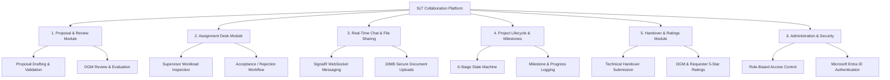
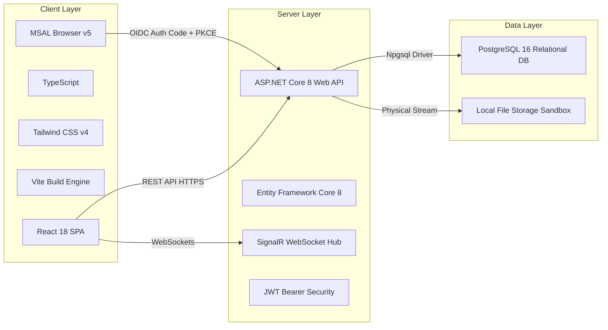
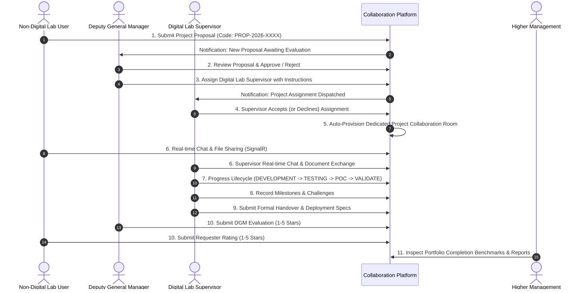

# SLT Inter-Departmental Project Communication & Collaboration System
## Document 1: System Overview

---

### Document Information
- **Document Reference:** SLT-DOC-2026-SYS-001
- **Document Title:** System Overview & Executive Summary
- **Classification:** CONFIDENTIAL &bull; INTERNAL HANDOVER
- **Version:** 1.0.0 (Production Candidate)
- **Prepared Date:** November 2026
- **Target Audience:** SLT Project Stakeholders, DGM, Supervisors, System Administrators, Executive Management

---

# 1. Project Introduction & Background

Sri Lanka Telecom (SLT-MOBITEL) is the premier national Information and Communications Technology (ICT) solutions provider and the leading broadband and backbone infrastructure operator in Sri Lanka. As part of SLT's ongoing corporate digital transformation agenda, the **Digital Services Lab (Digital Lab)** operates as the technological research, rapid prototyping, and innovation hub for the organization.

Prior to the deployment of this system, cross-functional project collaboration between non-digital operational departments (such as Network Operations, Enterprise Business, Marketing, Finance, and Human Resources) and the Digital Lab relied on fragmented communication channels. Project initiatives, internal software tools, automation bots, and Proof of Concept (POC) systems were requested through unstructured emails, physical inter-office memos, and informal phone conversations.

To eliminate operational silos and establish enterprise-grade governance, the **SLT Inter-Departmental Project Communication & Collaboration System** was commissioned. This centralized web platform facilitates end-to-end digital collaboration—from initial project proposal submission and executive DGM approval to dedicated supervisor assignment, real-time SignalR chat, secure business document sharing, milestone-driven lifecycle tracking, formal digital handover, and multi-dimensional performance evaluation.

---

# 2. Problem Statement

Before the introduction of the centralized collaboration system, cross-departmental innovation faced significant operational challenges:

1. **Information Silos & Scattered Communications:** Project requirements, architectural specifications, and bug reports were scattered across personal email inboxes, messaging apps, and local hard drives, creating single points of failure and significant information loss when personnel transitioned.
2. **Lack of Transparent Proposal Tracking:** Non-Digital Lab departments had no centralized visibility into the status of their submitted project requests. Proposals remained in unacknowledged review queues without defined timelines or accountable review criteria.
3. **Informal Supervisor Assignment:** Supervisor assignments were managed informally without tracking supervisor workload, technical specialization, or formal acceptance/rejection mechanisms.
4. **Missing Centralized Audit Trails:** Historical project decisions, status approvals, requirement amendments, and file exchanges lacked cryptographic logging, making post-implementation audits and SLA compliance verification impossible.
5. **Absence of Structured Handover & Evaluation Loops:** Projects frequently concluded without structured technical documentation, formal sign-off, or quantifiable performance ratings from the sponsoring departments.

---

# 3. Project Objectives

The primary objectives of the SLT Collaboration System are:

- **Centralized Digital Proposal Submission:** Provide non-digital lab departments with a structured, standardized mechanism to submit detailed business challenges, expected quantified impacts, and technical requirements.
- **Executive Governance & Review:** Empower the Deputy General Manager (DGM) to systematically evaluate incoming proposals with transparent approval remarks or clear rejection rationales.
- **Structured Supervisor Assignment:** Establish an accountable assignment workflow where the DGM pairs approved projects with qualified Digital Lab specialists, who must formally accept or decline with documented justification.
- **Dedicated Real-Time Collaboration Rooms:** Automatically provision secure, SignalR-powered project collaboration channels immediately upon assignment acceptance, enabling instant messaging and document exchange among project participants.
- **Rigorous 6-Stage Lifecycle Tracking:** Enforce a standardized engineering progression:
  $$\text{ASSIGNED} \longrightarrow \text{DEVELOPMENT} \longrightarrow \text{TESTING} \longrightarrow \text{POC} \longrightarrow \text{VALIDATE} \longrightarrow \text{HANDOVER}$$
- **Formal Handover Artifacts:** Mandate structured digital handovers with architecture documentation links, deployment specifications, limitations, and operational recommendations.
- **360-Degree Performance Evaluation:** Capture multi-dimensional 5-star ratings and qualitative reviews from both the DGM and the project requester to benchmark Digital Lab delivery velocity and quality.
- **Role-Tailored Dashboards:** Deliver tailored metrics and analytics across five distinct system roles to ensure total transparency.

---

# 4. System Scope & Core Functionalities

The platform encompasses six core functional modules:

### 4.1 Proposal & Review Module
- Standardized submission forms capturing Project Code, Title, Description, Business Problem, Expected Outcome, Quantified Impact, and Additional Information.
- Unique autogenerated project identification codes (e.g., `PROP-2026-0014`).
- DGM review queue with real-time status transitions (`PENDING_REVIEW`, `APPROVED`, `REJECTED`).

### 4.2 Assignment Desk Module
- Supervisor directory displaying current active project loads and departmental affiliations.
- Assignment dispatch with customized management instructions, expected completion targets, and priority flags.
- Dedicated supervisor inbox with acceptance and decline options (decline requires detailed explanation).

### 4.3 Real-Time Project Collaboration & File Sharing
- Dedicated project channels created automatically upon assignment acceptance.
- Real-time bi-directional messaging powered by ASP.NET Core SignalR.
- Secure file sharing supporting PDF, Word (`.doc`, `.docx`), Excel (`.xls`, `.xlsx`), PowerPoint (`.ppt`, `.pptx`), PNG, JPEG, CSV, and Plain Text files up to 10 MB.
- In-memory file signature validation and server-side obfuscated file storage.
- Safe inline preview for PDF and image formats; forced download for executable/binary documents.

### 4.4 Project Lifecycle & Progress Tracking
- Strict linear progression through defined development phases.
- Milestone title, challenge notes, completed activities, and planned next steps logging.
- Status history timeline recording timestamped audit logs for every state transition.

### 4.5 Digital Handover & Multi-Dimensional Ratings
- Comprehensive handover submission including deliverables summary, repository/documentation links, deployment configuration, and known limitations.
- Dual-party performance evaluation: Requester ratings (business problem alignment, communication) and DGM ratings (engineering quality, delivery timeline).

### 4.6 Executive Dashboards & Audit Governance
- Real-time role-based KPI dashboards for all five system roles.
- Complete system audit logging recording 16 distinct event categories with IP addresses and timestamps.
- Dual-mode authentication: Enterprise PBKDF2-SHA256 password security and Microsoft Entra ID (Azure AD) single sign-on integration.

---

# 5. User Roles and Responsibilities

The system enforces strict Role-Based Access Control (RBAC) across five predefined user roles:

| User Role | System Identifier | Target Department / Persona | Key Responsibilities |
|---|---|---|---|
| **Non-Digital Lab User** | `NON_DIGITAL_LAB_USER` | Network Operations, Marketing, Enterprise Business, HR, Finance | - Drafts and submits project proposals. - Tracks proposal evaluation status. - Participates in project chat. - Downloads and uploads project documentation. - Submits formal Requester performance rating upon project handover. |
| **Deputy General Manager** | `DGM` | Executive Management (Digital Lab Governance) | - Reviews all submitted departmental proposals. - Approves proposals or rejects with formal feedback. - Assigns approved projects to Digital Lab supervisors. - Monitors portfolio-wide delivery progress. - Evaluates completed projects with DGM performance rating. |
| **Digital Lab User** | `DIGITAL_LAB_USER` | Digital Services Lab Engineers & Specialists | - Receives project assignments from the DGM. - Formally accepts or declines assignments with explanation. - Manages technical execution across development lifecycle. - Posts progress updates and milestone achievements. - Shares technical artifacts and documentation. - Submits formal project handover. |
| **Higher Management** | `HIGHER_MANAGEMENT` | Chief Technology Officer, General Managers, Directors | - Cross-departmental portfolio visibility. - Tracks departmental delivery velocity and success rates. - Inspects portfolio metrics, completion benchmarks, and ratings. - Read-only governance access across active projects. |
| **Administrator** | `ADMIN` | IT Infrastructure & Enterprise Systems Admin | - User account lifecycle management. - Departmental assignments and role administration. - Microsoft Entra ID identity mapping (`oid`/`tid`). - Audit log inspection and compliance verification. - System health and database integrity monitoring. |

---

# 6. Technology Stack

The platform is engineered using modern, open-source enterprise technologies:

### Frontend Technology
- **Framework:** React 18 (Single Page Application architecture)
- **Language:** TypeScript 5.3 (Strict type checking enabled)
- **Build Tool:** Vite 8.3 (High-performance HMR and optimized asset bundling)
- **Styling:** Tailwind CSS v4 (Custom SLT Corporate navy and green design tokens)
- **Icons:** Lucide React (Clean, accessible, purposeful iconography)
- **Identity Library:** `@azure/msal-browser` & `@azure/msal-react` v5 (Microsoft Entra ID Authorization Code Flow with PKCE)

### Backend Technology
- **Framework:** ASP.NET Core 8 Web API (C# 12, .NET 8 LTS)
- **ORM:** Entity Framework Core 8 (Code-First workflow with automated migrations)
- **Real-Time Engine:** ASP.NET Core SignalR (WebSocket transport with server-side authorization)
- **Database Driver:** Npgsql.EntityFrameworkCore.PostgreSQL 8.0
- **Security:** `System.IdentityModel.Tokens.Jwt` 8.23, `Microsoft.IdentityModel.Protocols.OpenIdConnect` 8.23
- **Password Security:** PBKDF2 with HMAC-SHA256 (100,000 iterations, 32-byte cryptographically secure salt)

### Database & Storage
- **Relational Database:** PostgreSQL 16 (ACID compliance, JSONB support, filtered unique indexes)
- **File Storage:** Local server sandbox storage with randomized GUID-based filename obfuscation and MIME-type integrity checking

---

# 7. Business Benefits

Deploying the SLT Collaboration System provides measurable organizational benefits:

1. **Enhanced Operational Efficiency:** Eliminates repetitive email chains and telephone follow-ups. Proposal submission and approval cycles are reduced from weeks to hours.
2. **Accountability & Transparency:** Every project action—from initial proposal to final review—is recorded with an immutable audit log containing user ID, IP address, and UTC timestamp.
3. **Structured Digital Asset Retention:** Technical documentation, architectural blueprints, deployment guides, and progress reports are permanently indexed alongside the project record, preventing loss of corporate IP.
4. **Data-Driven Performance Management:** Objective multi-dimensional ratings provide leadership with empirical data on engineering efficiency, communication velocity, and internal customer satisfaction.
5. **Enterprise Security & Compliance:** Unified identity governance supporting SLT's corporate Microsoft 365 / Entra ID tenant alongside local access guards prevents unauthorized access and privilege escalation.

---

# 8. End-to-End Workflow

The complete end-to-end operational lifecycle follows an 11-step standardized sequence:

1. **Proposal Submission:** Requester completes the standardized digital form with business problem, expected impact, and initial scope.
2. **DGM Evaluation:** DGM assesses alignment with corporate goals and either approves or rejects with feedback.
3. **Supervisor Assignment:** DGM reviews supervisor availability and assigns the project with delivery instructions.
4. **Assignment Response:** Supervisor reviews requirements and accepts or declines (with mandatory justification).
5. **Chat Room Provisioning:** Acceptance automatically triggers creation of an isolated collaboration channel.
6. **Real-Time Communication:** Participants exchange instant messages and project files up to 10 MB.
7. **Lifecycle Progression:** Supervisor transitions project through engineering phases (`DEVELOPMENT`, `TESTING`, `POC`, `VALIDATE`, `HANDOVER`).
8. **Milestone Logging:** Supervisor documents milestones, challenge resolutions, and upcoming tasks.
9. **Handover Submission:** Supervisor submits the formal handover report with deliverables and documentation links.
10. **Dual-Party Rating:** DGM and Requester independently submit 1-5 star ratings across quality and delivery dimensions.
11. **Dashboard & Reporting:** Executive dashboards reflect updated completion benchmarks and KPI metrics.

---

*End of Document 1: System Overview.*
