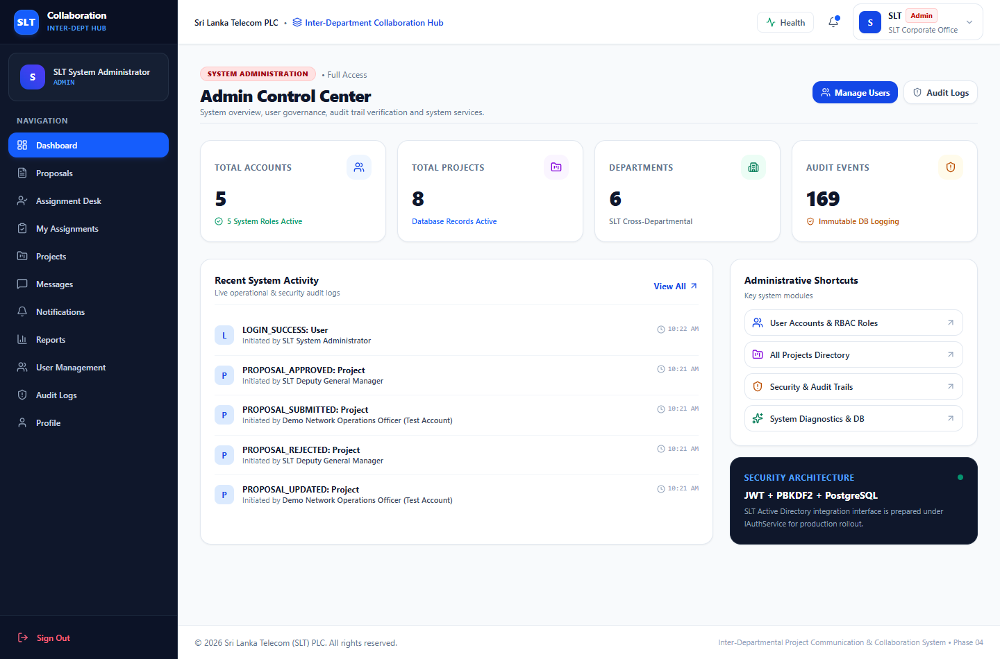
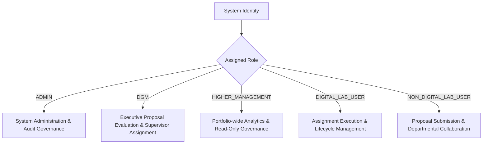
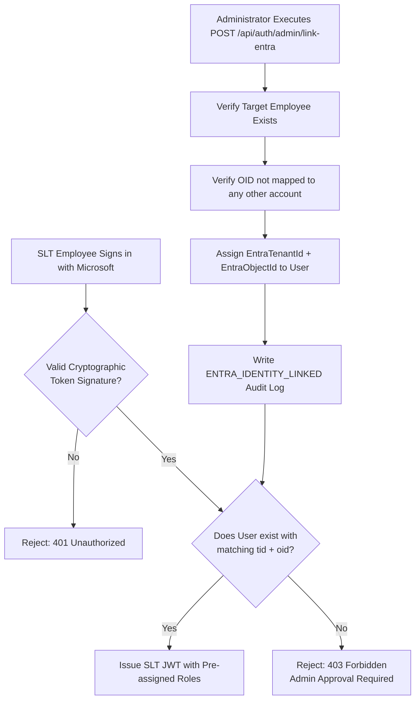

# SLT Inter-Departmental Project Communication & Collaboration System
## Document 6: System Administrator & Security Guide

---

### Document Information
- **Document Reference:** SLT-DOC-2026-ADM-006
- **Document Title:** System Administrator & Security Guide
- **Classification:** CONFIDENTIAL &bull; INTERNAL HANDOVER
- **Version:** 1.0.0 (Production Candidate)
- **Prepared Date:** November 2026
- **Target Audience:** System Administrators, DevOps Engineers, Security Officers, Database Administrators

---

# 1. Administrator Dashboard & System Overview

The System Administrator (`ADMIN`) role is responsible for user lifecycle management, Role-Based Access Control (RBAC) governance, Microsoft Entra ID enterprise identity linking, audit log oversight, system configuration, and data integrity.

### 1.1 Administrator Governance Dashboard
Upon logging in as an Administrator (e.g., `slt.admin`), the administrative dashboard provides an overview of system health and activity metrics.



### Key Metrics Monitored:
- **Total System Users:** Total active registered accounts across all departments.
- **Total Registered Projects:** Cross-departmental innovation initiatives in the system.
- **Active Chat Collaboration Channels:** Dedicated SignalR project rooms currently open.
- **Total Audit Logs:** Cumulative count of tracked security and operational events.
- **Recent System Activities Stream:** Real-time chronological audit trail of all logins, evaluations, assignments, and file uploads.

---

# 2. User Account & Identity Management

### 2.1 Role-Based Access Control (RBAC) Architecture
The system enforces the Principle of Least Privilege across five predefined enterprise roles:



| Role Name | Identifier | Department Scope | Permitted Capabilities |
|---|---|---|---|
| **System Administrator** | `ADMIN` | IT & Enterprise Systems | Full system configuration, user identity linking, audit log inspection, and health monitoring. |
| **Deputy General Manager** | `DGM` | Corporate Management | Proposal approval/rejection, supervisor assignment dispatch, project ratings. |
| **Higher Management** | `HIGHER_MANAGEMENT` | Executive Suite | Portfolio delivery benchmarks, stage duration analytics, read-only oversight. |
| **Digital Lab Specialist** | `DIGITAL_LAB_USER` | Digital Services Lab | Project acceptance/decline, sprint updates, milestone logging, file sharing, formal handover. |
| **Non-Digital Lab Requester** | `NON_DIGITAL_LAB_USER` | Operational Business Units | Proposal drafting, project tracking, collaboration chat, requester rating submission. |

### 2.2 User Provisioning & Account Protection
To prevent unauthorized privilege escalation and protect corporate data:
- **Restricted Profile Editing:** Regular employees cannot alter their usernames, email addresses, department codes, or role assignments through the web interface.
- **Database Seeding & Admin API:** Core user accounts are provisioned via administrative database migrations or authorized API calls.
- **Password Security:** Local credentials use PBKDF2 with HMAC-SHA256 (100,000 iterations, 32-byte salt). Passwords are never stored in plain text.
- **Account Deactivation:** Inactive users have `IsActive = false`, which immediately invalidates session generation and denies API authentication.

---

# 3. Microsoft Entra ID Administration

The platform includes integration with Microsoft Entra ID (formerly Azure Active Directory).



> [!IMPORTANT]
> **Pending Corporate Tenant Configuration:**
> The Microsoft Entra ID authentication pipeline is implemented, cryptographically verified, and hardened. However, live single sign-on for SLT employees requires the official SLT Microsoft Entra tenant application registration to be completed by SLT IT. Until then, demo credentials and local accounts remain operational.

### 3.1 Administrator-Approved Account Linking Workflow
To prevent identity spoofing, the system **strictly prohibits automatic account linking based on unverified email claims alone**. Administrators must explicitly bind an employee's Microsoft Entra identity (`oid`) to their system account:

1. Obtain the employee's **Object ID (`oid`)** and the SLT **Directory Tenant ID (`tid`)** from the Azure Portal (under *Microsoft Entra ID $\rightarrow$ Users*).
2. Execute the administrative linking API:
```http
POST /api/auth/admin/link-entra
Authorization: Bearer <Admin_JWT_Token>
Content-Type: application/json

{
  "userId": "13c417de-b0b9-4040-9463-388bace01e5f",
  "entraTenantId": "72f988bf-86f1-41af-91ab-2d7cd011db47",
  "entraObjectId": "entra-oid-supervisor-1234"
}
```
3. The system validates:
   - Target user exists and is active.
   - The `(entraTenantId, entraObjectId)` combination is not already mapped to another user.
   - The `entraObjectId` is not duplicated.
4. An `ENTRA_IDENTITY_LINKED` event is recorded in the audit trail.
5. On the employee's next login, the system matches their Microsoft token and grants access with their pre-assigned roles.

### 3.2 Unlinking an Identity
To revoke an employee's Microsoft Entra binding:
```http
POST /api/auth/admin/unlink-entra/{userId}
Authorization: Bearer <Admin_JWT_Token>
```
The identity mapping is cleared, and an `ENTRA_IDENTITY_UNLINKED` audit log is recorded.

---

# 4. Audit Log Supervision & Governance

The platform maintains an immutable audit log in PostgreSQL (`AuditLogs` table) tracking 16 security and operational event categories:

| Action Identifier | Description | Recorded Metadata |
|---|---|---|
| `LOGIN_SUCCESS` | Successful local / demo sign-in | User ID, Username, Client IP |
| `LOGIN_FAILED` | Failed password attempt or non-existent username | Attempted Username, Client IP |
| `ENTRA_LOGIN_SUCCESS` | Successful Microsoft Entra authentication | User ID, Microsoft `oid`, Client IP |
| `ENTRA_LOGIN_DENIED` | Blocked login for unlinked Microsoft account | Microsoft `oid`, Email, Client IP |
| `ENTRA_IDENTITY_LINKED` | Admin linked Microsoft identity to user | Admin ID, Target User ID, `oid`, `tid` |
| `ENTRA_IDENTITY_UNLINKED` | Admin revoked Microsoft identity mapping | Admin ID, Target User ID, Previous `oid` |
| `PROPOSAL_CREATED` | New project proposal submitted | Proposal ID, Project Code, Author ID |
| `PROPOSAL_APPROVED` | Proposal approved by DGM | Proposal ID, Evaluator DGM ID |
| `PROPOSAL_REJECTED` | Proposal rejected by DGM | Proposal ID, Evaluator DGM ID, Reason |
| `SUPERVISOR_ASSIGNED` | DGM assigned supervisor to project | Assignment ID, Supervisor ID, Project ID |
| `ASSIGNMENT_ACCEPTED` | Supervisor accepted project assignment | Assignment ID, Project ID, Room ID |
| `ASSIGNMENT_DECLINED` | Supervisor declined project assignment | Assignment ID, Decline Reason |
| `STATUS_CHANGED` | Project advanced through lifecycle | Project ID, Previous Status, New Status |
| `PROGRESS_UPDATED` | Milestone or sprint update recorded | Update ID, Project ID, Milestone Title |
| `HANDOVER_SUBMITTED` | Supervisor submitted formal handover | Handover ID, Project ID, Deliverables |
| `RATING_SUBMITTED` | Performance evaluation submitted | Rating ID, Score, Rater Type (`DGM`/`REQ`) |
| `ATTACHMENT_UPLOADED` | Document attached in project chat | Attachment ID, File Name, Size Bytes |
| `ATTACHMENT_DOWNLOADED`| Participant downloaded file attachment | Attachment ID, Downloader User ID |

### Audit Log Inspection
Administrators can inspect recent audit entries directly from the Admin Dashboard or query the database:
```sql
SELECT "Timestamp", "Action", "EntityName", "EntityId", "Details", "IpAddress"
FROM "AuditLogs"
ORDER BY "Timestamp" DESC
LIMIT 50;
```

---

# 5. System Configuration & Environment Settings

Configuration is managed via environment variables and `appsettings.json`.

### 5.1 Backend Configuration (`backend/appsettings.json`)
```json
{
  "Logging": {
    "LogLevel": {
      "Default": "Information",
      "Microsoft.AspNetCore": "Warning"
    }
  },
  "AllowedHosts": "*",
  "Database": {
    "Host": "localhost",
    "Port": "5432",
    "Name": "slt_collab_db",
    "User": "postgres"
  },
  "MicrosoftEntra": {
    "Instance": "https://login.microsoftonline.com/",
    "TenantId": "00000000-0000-0000-0000-000000000000",
    "ClientId": "00000000-0000-0000-0000-000000000000",
    "Audience": "api://00000000-0000-0000-0000-000000000000",
    "RedirectUri": "http://127.0.0.1:5173/login",
    "Scope": "openid profile email User.Read"
  }
}
```

### 5.2 Environment Variables Reference
| Variable | Component | Purpose | Production Value Example |
|---|---|---|---|
| `ASPNETCORE_ENVIRONMENT` | Backend | Environment profile | `Production` |
| `Database__Password` | Backend | PostgreSQL service password | `*SecureSecret*` |
| `ENTRA_TENANT_ID` | Backend | SLT Microsoft Entra Directory ID | `a1b2c3d4-e5f6-...` |
| `ENTRA_CLIENT_ID` | Backend | Registered App Application ID | `f1e2d3c4-b5a6-...` |
| `ENTRA_AUDIENCE` | Backend | Token audience validation | `api://f1e2d3c4-b5a6-...` |
| `VITE_ENTRA_TENANT_ID` | Frontend | Tenant ID for client MSAL | `a1b2c3d4-e5f6-...` |
| `VITE_ENTRA_CLIENT_ID` | Frontend | Application ID for client MSAL | `f1e2d3c4-b5a6-...` |
| `VITE_ENTRA_REDIRECT_URI` | Frontend | Post-login OAuth redirect URI | `https://collab.slt.lk/login` |

---

# 6. Database Maintenance & Backup Strategies

### 6.1 Database Backup Strategy
The `slt_collab_db` database should be backed up regularly using PostgreSQL native tools:

#### Automated Daily Backup (pg_dump):
```bash
pg_dump -h localhost -U postgres -d slt_collab_db -F c -b -v -f "/backup/slt_collab_db_$(date +%Y%m%d_%H%M%S).dump"
```

#### Point-in-Time Recovery (PITR):
Enable Write-Ahead Logging (WAL) archiving in `postgresql.conf`:
```ini
wal_level = replica
archive_mode = on
archive_command = 'cp %p /var/lib/postgresql/wal_archive/%f'
```

### 6.2 Schema Migrations
Database schema updates must be applied using EF Core:
```powershell
cd backend
dotnet ef database update
```
All four formal migrations (`InitialCreate`, `AddChatAttachments`, `AddMicrosoftEntraIdentity`, and `AddEntraIdentityUniqueConstraints`) are idempotent and safe to execute against existing databases.

---

# 7. File Storage & Sandbox Security

Uploaded project documents are stored in the server's sandboxed directory:
- **Default Directory:** `backend/uploads/attachments/`
- **File Naming Convention:** Obfuscated randomized GUID (e.g., `8f3b2a1c-4d5e-6f7a-8b9c-0d1e2f3a4b5c.pdf`).

### 7.1 Security Measures:
- **No Path Traversal:** User-supplied filenames are never used in physical filesystem paths.
- **MIME & Extension Whitelist:** Executable files (`.exe`, `.bat`, `.cmd`, `.sh`, `.msi`) are rejected.
- **Quota Management:** Enforced limit of 10 MB per file attachment.
- **Backup Synchronization:** The `uploads/attachments/` folder must be backed up alongside the PostgreSQL database to preserve document availability.

---

# 8. Troubleshooting Guide

### 8.1 Common Operational Issues & Resolutions

| Issue | Root Cause | Resolution |
|---|---|---|
| **Database Connection Refused** (`57P01` / `08001`) | PostgreSQL service stopped or credentials incorrect. | Verify PostgreSQL service is running (`systemctl status postgresql` or Windows Services). Verify port 5432 and `slt_collab_db` credentials in `appsettings.json`. |
| **Microsoft Sign-In Returns "Access Denied"** (`403 Forbidden`) | The Microsoft account is authenticated, but not yet linked to an SLT employee account. | Use the admin endpoint `POST /api/auth/admin/link-entra` to map the employee's `oid` and `tid`. |
| **Microsoft Sign-In Returns "Invalid Signature"** (`401`) | Token was signed with an untrusted key, tampered with, or expired. | Verify that the Azure App Registration has granted required API permissions (`openid`, `profile`, `email`, `User.Read`) and that system clock skew does not exceed 2 minutes. |
| **SignalR Chat Disconnections** | Client lost WebSocket connection or network proxy closed idle socket. | The frontend client automatically reconnects (`withAutomaticReconnect`). In production behind Nginx/HAProxy, ensure WebSocket upgrade headers are passed: `proxy_set_header Upgrade $http_upgrade;` and `proxy_set_header Connection "upgrade";`. |
| **File Upload Fails with "Payload Too Large"** (`413`) | Uploaded file exceeds the 10 MB limit. | Instruct user to compress document or split files. In production reverse proxies (e.g., Nginx), set `client_max_body_size 12M;`. |

---

# 9. Pre-Production Handover Checklist for SLT IT

Before moving to production with the official SLT corporate tenant:

- [ ] **Azure App Registration:** Register `SLT Collaboration Platform` in the SLT Microsoft Entra tenant.
- [ ] **Redirect URIs:** Add `https://collab.slt.lk/login` as an authorized Single-Page Application (SPA) redirect URI.
- [ ] **API Permissions:** Grant delegated permissions: `openid`, `profile`, `email`, `User.Read`.
- [ ] **Production Keys:** Configure `ENTRA_TENANT_ID`, `ENTRA_CLIENT_ID`, and `ENTRA_AUDIENCE` on the production server.
- [ ] **SSL/TLS Certificates:** Install a valid corporate SSL/TLS certificate for HTTPS (`https://collab.slt.lk`) and WSS (`wss://collab.slt.lk`).
- [ ] **Admin Pre-Mapping:** Identify initial Digital Lab supervisors and pre-link their Entra Object IDs via `/api/auth/admin/link-entra`.
- [ ] **Backup Schedule:** Configure automated daily backups of `slt_collab_db` and `/uploads/attachments/`.

---

*End of Document 6: System Administrator & Security Guide.*
