# SLT Inter-Departmental Project Communication & Collaboration System
## Document 5: System User Manual

---

### Document Information
- **Document Reference:** SLT-DOC-2026-USR-005
- **Document Title:** End-User Operation & User Manual
- **Classification:** CONFIDENTIAL &bull; INTERNAL HANDOVER
- **Version:** 1.0.0 (Production Candidate)
- **Prepared Date:** November 2026
- **Target Audience:** All System Users (Requesters, Supervisors, DGM, Executives, Departmental Staff)

---

# 1. Introduction

Welcome to the **SLT Inter-Departmental Project Communication & Collaboration System**. This platform is designed to make project collaboration between non-digital departments and the SLT Digital Services Lab smooth, transparent, and efficient.

Whether you are proposing a new automation tool, evaluating incoming project requests, managing engineering development sprints, or reviewing executive completion reports, this user manual provides clear, step-by-step instructions.

---

# 2. System Requirements & Access

### 2.1 Supported Web Browsers
The system is built as a responsive modern web application compatible with:
- Google Chrome (Version 110 or higher) - *Recommended*
- Microsoft Edge (Version 110 or higher) - *Recommended*
- Mozilla Firefox (Version 115 or higher)
- Apple Safari (Version 16 or higher)

### 2.2 Access URLs
- **Internal Network URL:** `http://127.0.0.1:5173` (Development / Local Test)
- **Corporate Intranet URL:** `https://collab.slt.lk` (Production Deployment)

---

# 3. Getting Started: Sign-In & Navigation

### 3.1 Signing In
When you open the application, you are greeted by the corporate sign-in screen featuring SLT's signature blue branding.

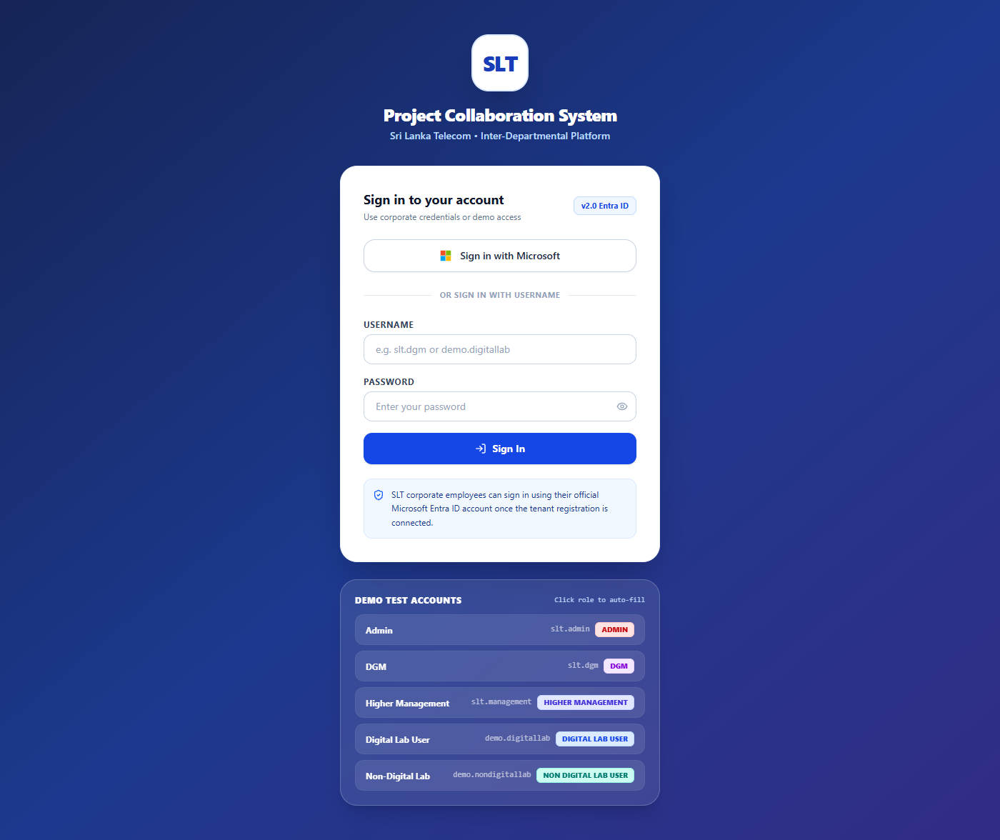

You can sign in using either of the following two methods:

#### Method A: Sign in with Microsoft (Corporate Entra ID)
1. Click the white **Sign in with Microsoft** button at the top of the login card.
2. If your SLT Microsoft 365 tenant is actively configured, a Microsoft login window opens. Enter your official `@slt.lk` email and password.
3. If the corporate tenant registration is pending configuration by SLT IT, an informative status notice appears explaining the required environment settings.

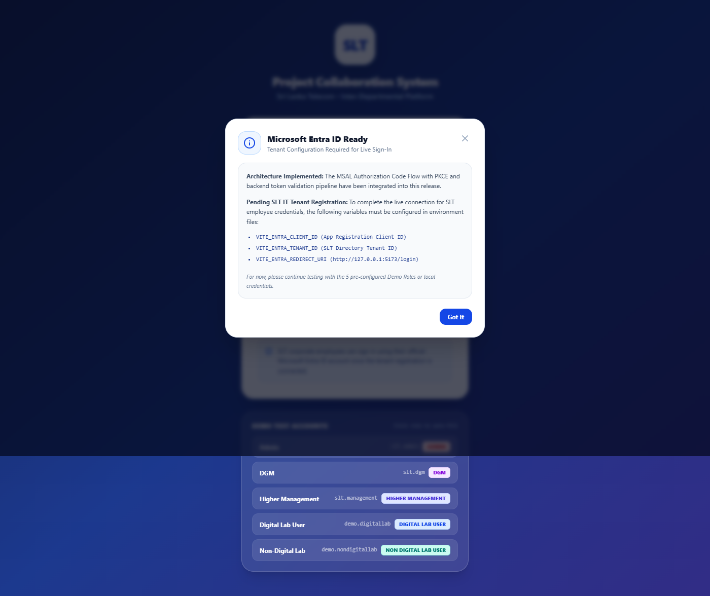

#### Method B: Username and Password (Local / Demo Credentials)
1. Enter your corporate **Username** (e.g., `slt.dgm`, `slt.admin`, `demo.digitallab`, or `demo.nondigitallab`).
2. Enter your **Password**.
3. Click the blue **Sign In** button.
4. For quick demonstration and testing, you can click any of the five pre-configured role pills at the bottom of the card (`Admin`, `DGM`, `Higher Management`, `Digital Lab User`, `Non-Digital Lab`) to automatically fill valid demo credentials.

### 3.2 Signing Out
To securely sign out of the application:
1. Locate the **Sign Out** button at the bottom of the left-hand navigation sidebar.
2. Click **Sign Out**. Your authentication token will be cleared from the browser and you will be returned to the login screen.

### 3.3 Main Navigation & Header
Once logged in, the top header displays your department name, live system connectivity indicator, real-time notification bell, and your user profile badge.

---

# 4. Requester Guide (Non-Digital Lab Users)

Non-Digital Lab users represent requesting business units such as Network Operations, Enterprise Solutions, Marketing, Finance, and HR.

### 4.1 Requester Workspace Overview
Upon signing in, you will see your departmental workspace summarizing submitted proposals, approval counts, and active projects.

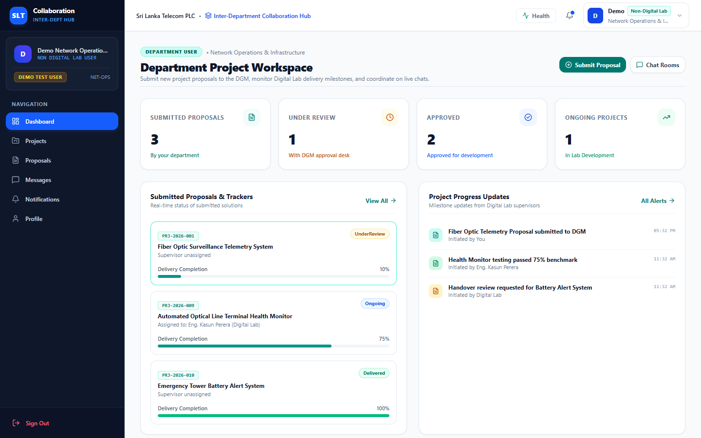

### 4.2 Submitting a New Project Proposal
To request an innovation project or technical solution from the Digital Lab:

1. Click **Proposals** on the left navigation sidebar.
2. Click the blue **+ Submit Proposal** button.
3. Fill in the required proposal fields:

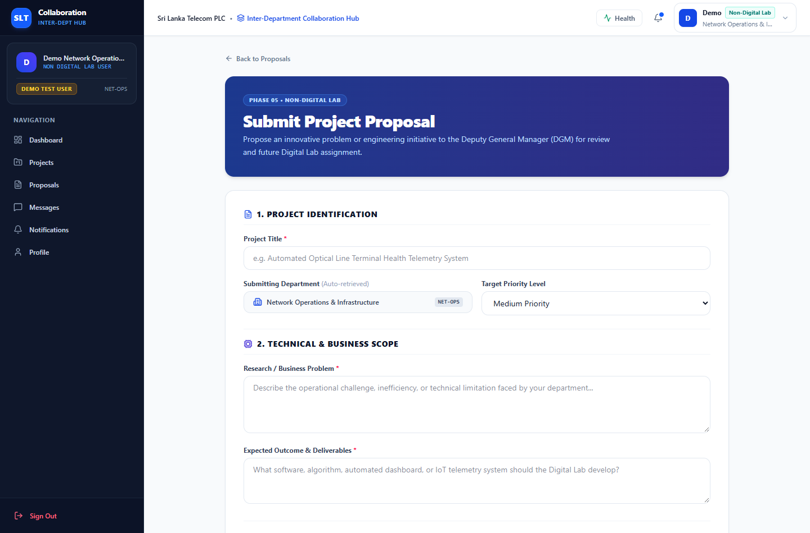

- **Project Title:** A concise, descriptive name (e.g., *Automated Fiber Cable Diagnostic System*).
- **Executive Description:** A high-level summary of what the system will do.
- **Business Problem:** Detailed explanation of the current operational issue or bottleneck.
- **Expected Outcome:** The target deliverable or technical capability required.
- **Quantified Impact:** Measurable benefit (e.g., *Reduces repair time by 60% and saves LKR 4.2M annually*).
- **Priority Level:** Choose from `LOW`, `MEDIUM`, `HIGH`, or `CRITICAL`.
- **Additional Information:** Any technical constraints, legacy API endpoints, or reference documents.

4. Click **Submit Proposal**. A unique tracking code (e.g., `PROP-2026-0014`) is automatically generated, and the proposal is placed in the DGM's review queue.

### 4.3 Tracking Your Proposals
Navigate to **My Proposals** to view the live status of all submissions:
- `PENDING_REVIEW`: Awaiting DGM evaluation.
- `APPROVED`: Approved by DGM; ready for supervisor assignment.
- `REJECTED`: Declined with detailed explanation.
- `ASSIGNED` / `DEVELOPMENT`: Currently being engineered by the Digital Lab.

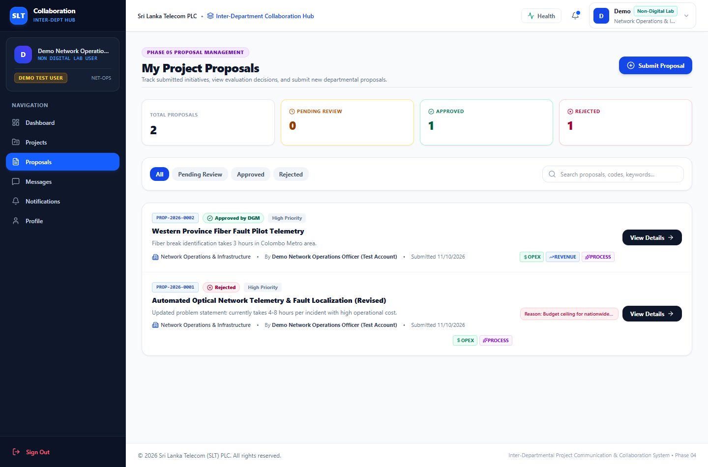

---

# 5. DGM Guide (Deputy General Manager)

The Deputy General Manager oversees project governance, evaluates submitted proposals, and assigns Digital Lab engineering specialists.

### 5.1 DGM Executive Governance Dashboard
The DGM dashboard highlights pending reviews, approved projects, ongoing laboratory projects, and active supervisor workloads.

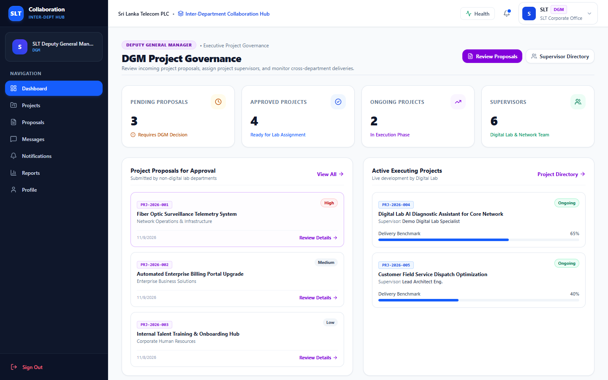

### 5.2 Evaluating Proposals
To review incoming proposals:
1. Click **Proposals** on the sidebar.
2. Select any proposal with the status `PENDING_REVIEW`.
3. Inspect the business problem, quantified impact, and proposed priority.

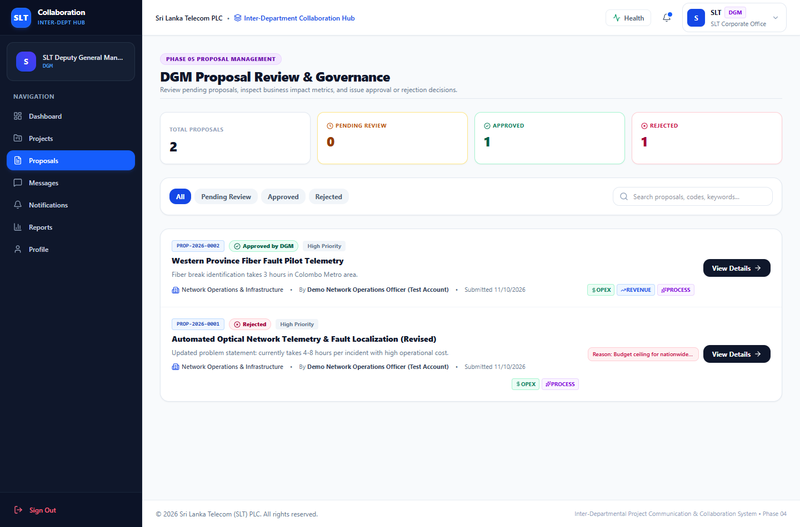

4. Click **Evaluate Proposal** to open the decision window:

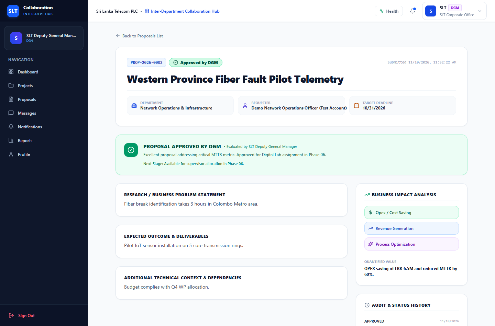

- **To Approve:** Select **Approve Proposal**, provide executive review remarks, and click **Submit Decision**. The proposal status updates to `APPROVED`.
- **To Reject:** Select **Reject Proposal**, enter a mandatory rejection explanation, and click **Submit Decision**. The requester is immediately notified.

### 5.3 Supervisor Assignment Desk
Once a proposal is approved, it appears in the **Assignment Desk**:

1. Click **Assignment Desk** on the sidebar.
2. Review the list of unassigned approved projects alongside the directory of Digital Lab supervisors.

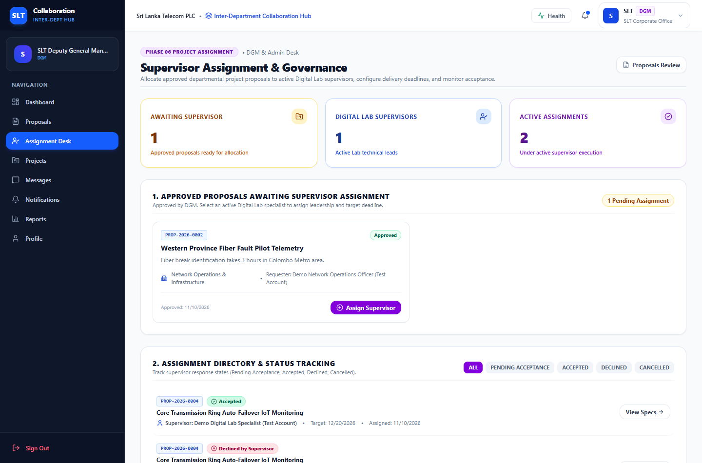

3. Click **Assign Supervisor** on the project card.
4. Select the qualified supervisor, assign their role (e.g., *Lead IoT Engineer*), and provide specific instructions or delivery deadlines:

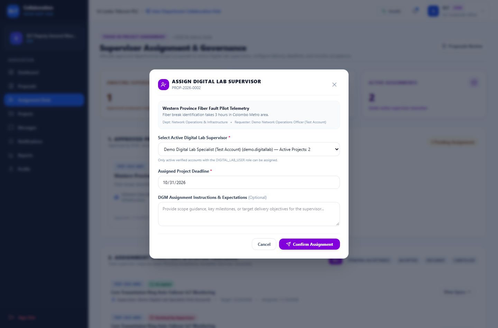

5. Click **Confirm Assignment**. An assignment notification is instantly dispatched to the supervisor.

---

# 6. Supervisor Guide (Digital Lab Engineers)

Digital Lab specialists build the technical solutions and manage the project execution lifecycle.

### 6.1 Supervisor Workspace
The supervisor workspace summarizes your active projects, pending assignments, and milestone deadlines.

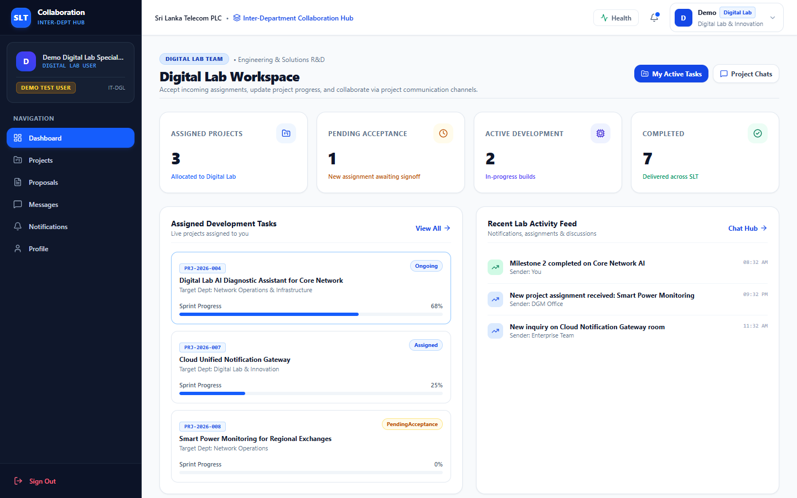

### 6.2 Accepting or Declining Assignments
When the DGM assigns you a project:

1. Click **Assignments** on your sidebar.
2. Locate the assignment marked `PENDING_ACCEPTANCE`.

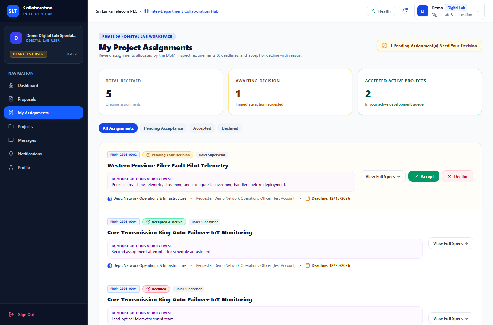

3. Click on the assignment to view the DGM's instructions and project requirements:

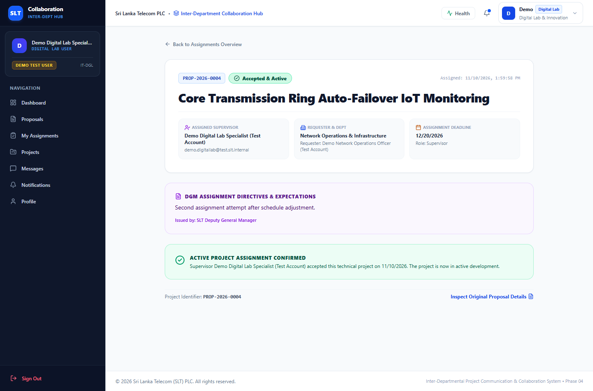

4. Choose your response:
   - **Accept Assignment:** Click the green **Accept Assignment** button. The project moves to `ASSIGNED` status, and a dedicated project chat channel is created.
   - **Decline Assignment:** Click the red **Decline Assignment** button. Enter a required explanation (e.g., workload constraints) and click **Submit Decline**.

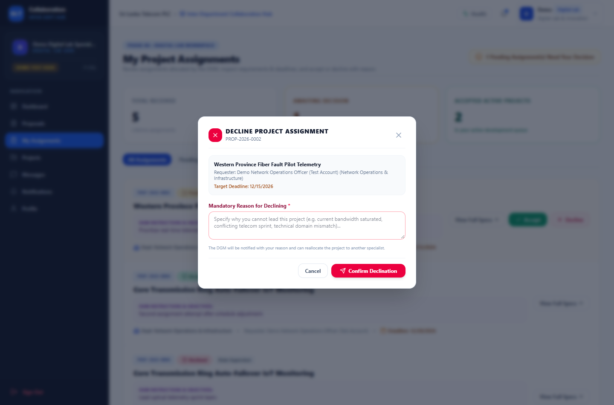

### 6.3 Managing the Project Execution Lifecycle
Once accepted, open the project details page to manage progress:

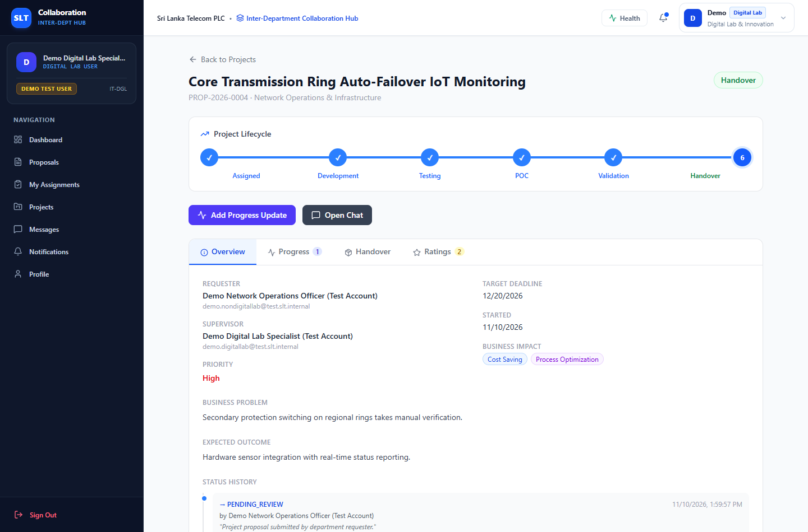

To update the engineering stage, click **Advance Stage** to progress sequentially through:
$$\text{ASSIGNED} \longrightarrow \text{DEVELOPMENT} \longrightarrow \text{TESTING} \longrightarrow \text{POC} \longrightarrow \text{VALIDATE} \longrightarrow \text{HANDOVER}$$

### 6.4 Recording Progress Updates & Milestones
During development, regularly post progress updates:
1. On the project page, click **Add Progress Update**.
2. Select the update type: `WEEKLY_UPDATE`, `MILESTONE`, or `CRITICAL_ISSUE`.
3. Enter completed activities, current challenges, next steps, and milestone titles.

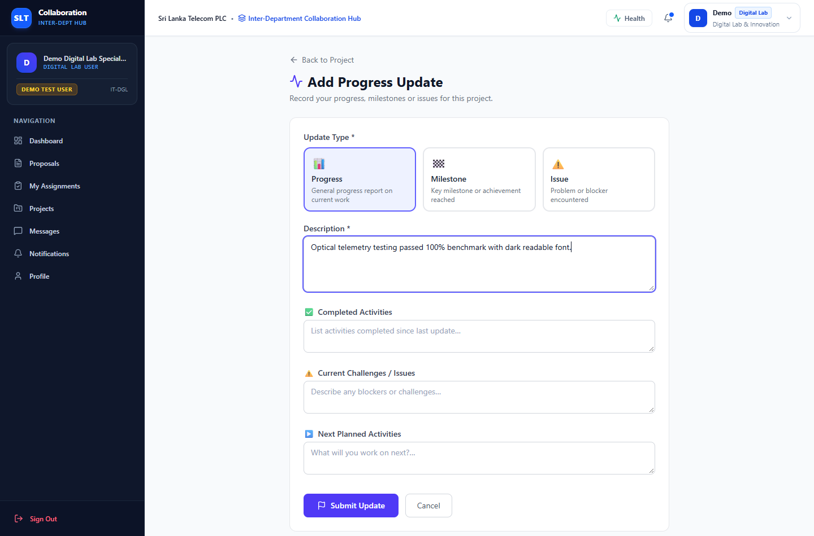

4. Click **Save Update**. The update is permanently recorded in the project timeline.

### 6.5 Submitting Formal Project Handover
When development and validation are complete, advance the project to `HANDOVER` status and submit the final deliverables report:

1. Click **Submit Handover**.
2. Complete the formal handover form:
   - **Final Executive Summary:** Summary of delivered capabilities.
   - **Deliverables Completed:** List of codebases, binaries, and dashboards delivered.
   - **Technical Documentation Links:** URLs to Git repositories, architecture blueprints, or internal wikis.
   - **Deployment Details:** Server hostnames, port numbers, container configurations.
   - **Known Limitations:** Any known operational boundaries.
   - **Operational Recommendations:** Maintenance and monitoring guidance.

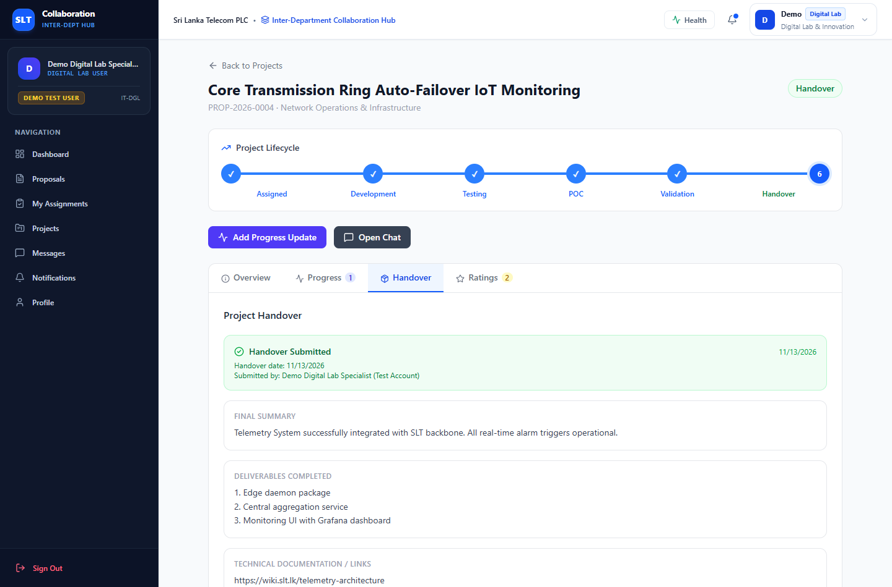

3. Click **Submit Handover**. The project status advances, and both the DGM and Requester are invited to provide final performance ratings.

---

# 7. Real-Time Chat & File Attachments

Every accepted project has an isolated collaboration channel accessible by the Requester, the Supervisor, and the DGM.

### 7.1 Accessing Project Chat
- Click **Messages** on the sidebar, or click the **Open Project Chat** button directly from any project details page.

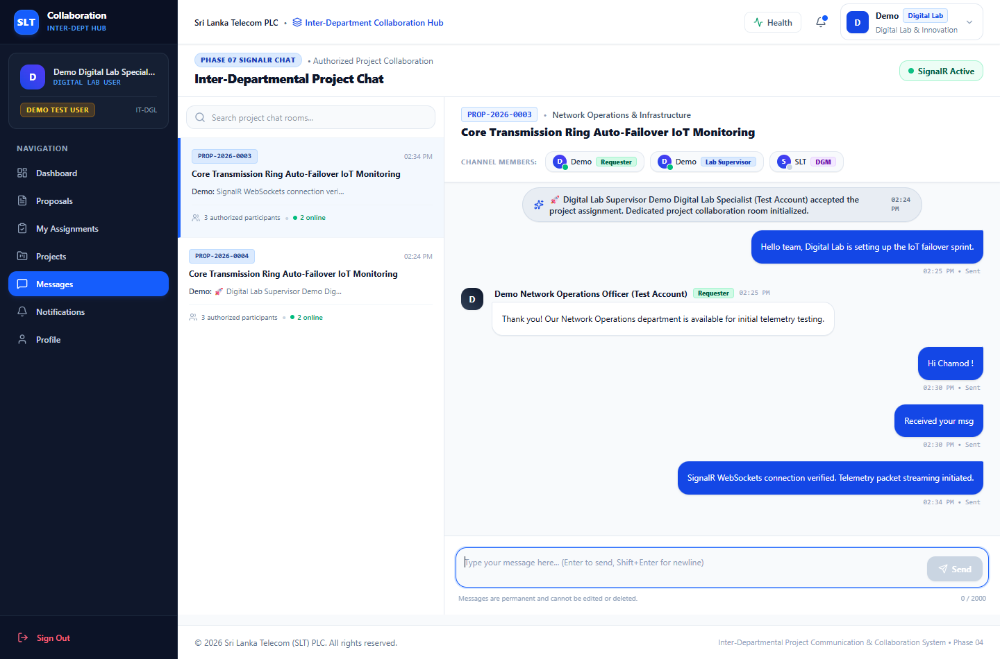

### 7.2 Sending Messages
- Type your message in the text input box at the bottom and press **Enter** or click the blue send icon. Messages appear instantly for all online participants via WebSockets.

### 7.3 Attaching Project Documents
You can share documents up to **10 MB** in size:

1. Click the **+** (attachment) icon beside the message input box.
2. Select a file from your computer (`.pdf`, `.docx`, `.xlsx`, `.pptx`, `.png`, `.jpg`, `.csv`, `.txt`).
3. The selected file name and size will be displayed above the input box:

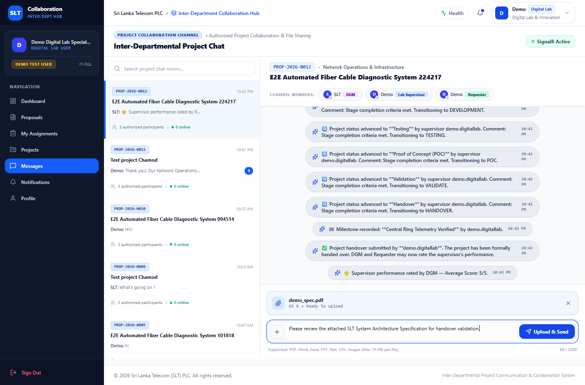

4. Type an optional message describing the document and click **Send**.
5. The document appears in the chat stream as an interactive card displaying file name, extension badge, and file size:

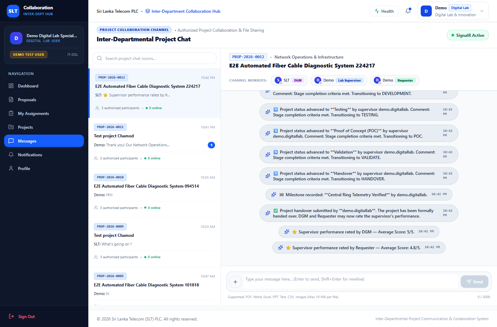

### 7.4 Downloading & Viewing Attachments
- **To View Inline:** Click the **View** button on PDF or image cards to preview the document directly in a secure browser tab.
- **To Download:** Click the **Download** button to save the file to your computer.

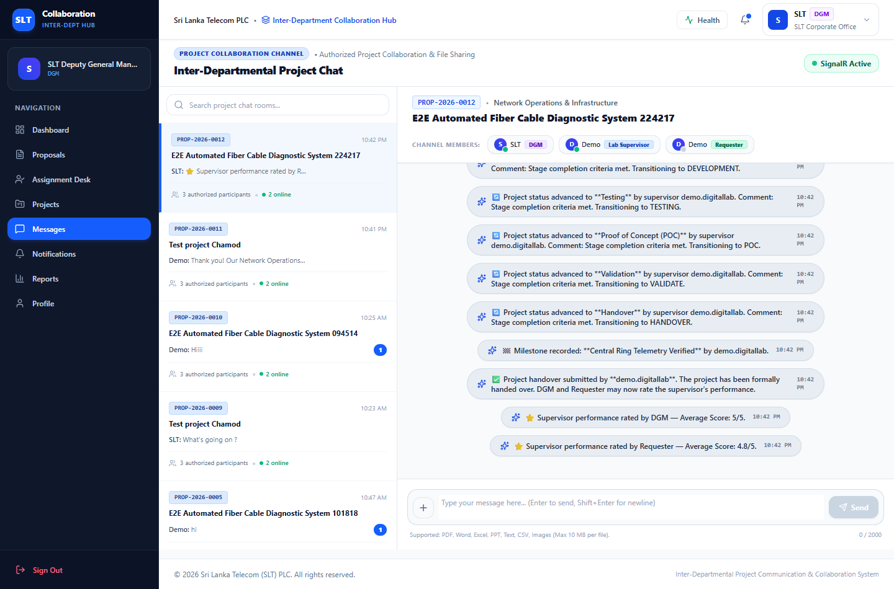

---

# 8. Performance Evaluation & Ratings

When a project reaches the handover stage, both the DGM and the Requester submit performance ratings to benchmark Digital Lab execution.

### 8.1 Submitting Ratings
1. Open the project page and navigate to the **Performance Evaluation** tab.
2. Rate the project on a 1-to-5 star scale across four categories:
   - **Overall Satisfaction:** General delivery success.
   - **Technical Quality:** Engineering robustness and reliability.
   - **Delivery Speed:** Adherence to agreed timelines.
   - **Communication Responsiveness:** Collaboration effectiveness.
3. Add optional written feedback and click **Submit Evaluation**.

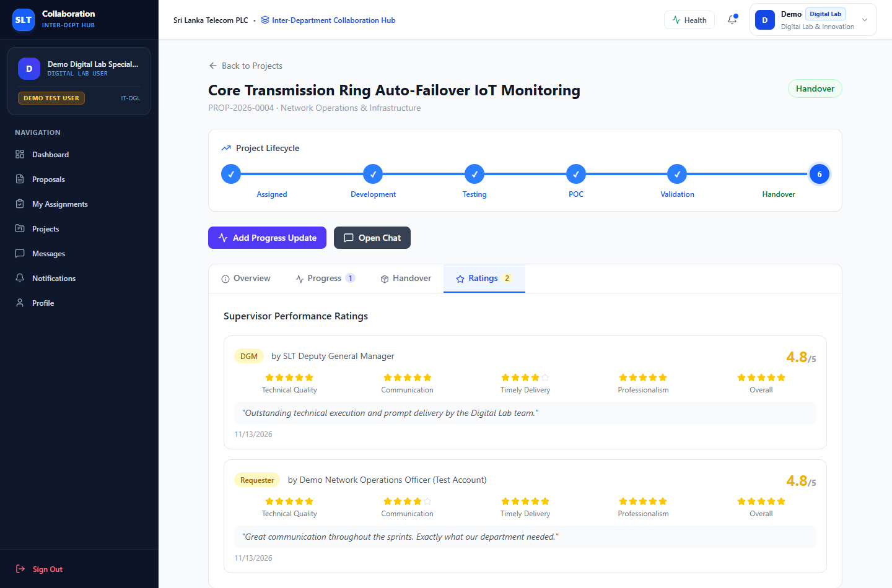

---

# 9. Higher Management Guide

Higher Management users (CTO, General Managers, Directors) have cross-departmental oversight of the innovation portfolio.

### 9.1 Executive Dashboard
The executive dashboard highlights portfolio completion percentages, active project counts, and average delivery ratings.

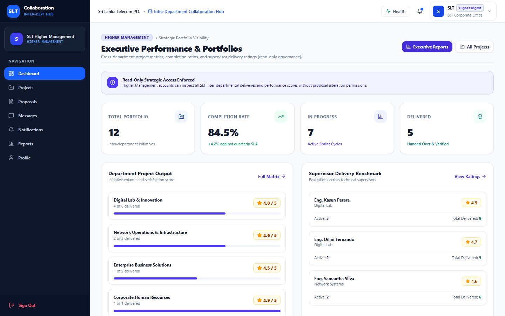

### 9.2 Executive Reports & Portfolio Analytics
Navigate to **Reports** to inspect detailed delivery benchmark matrices, department-by-department comparisons, and stage duration metrics.

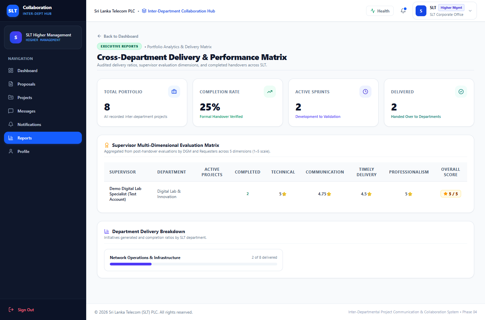

---

# 10. Notifications

The notification bell in the top navigation bar provides real-time alerts whenever:
- A new proposal is submitted.
- A proposal is approved or rejected.
- You are assigned a project.
- A new chat message or file attachment is received.
- A handover is submitted and ready for evaluation.

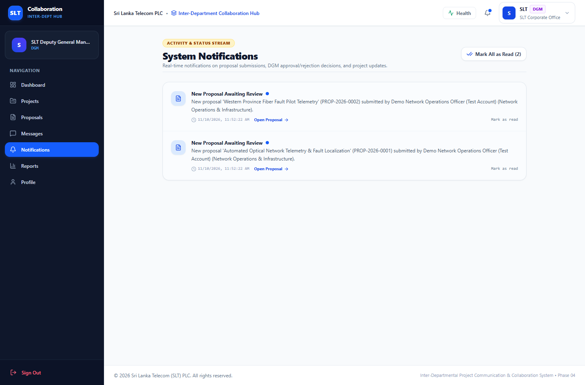

- Click any notification to navigate directly to the relevant project or chat room.
- Click **Mark all as read** to clear unread alert badges.

---

# 11. Profile Information

Click your user avatar in the top right to view your profile details, including your username, email, department code, and assigned roles.

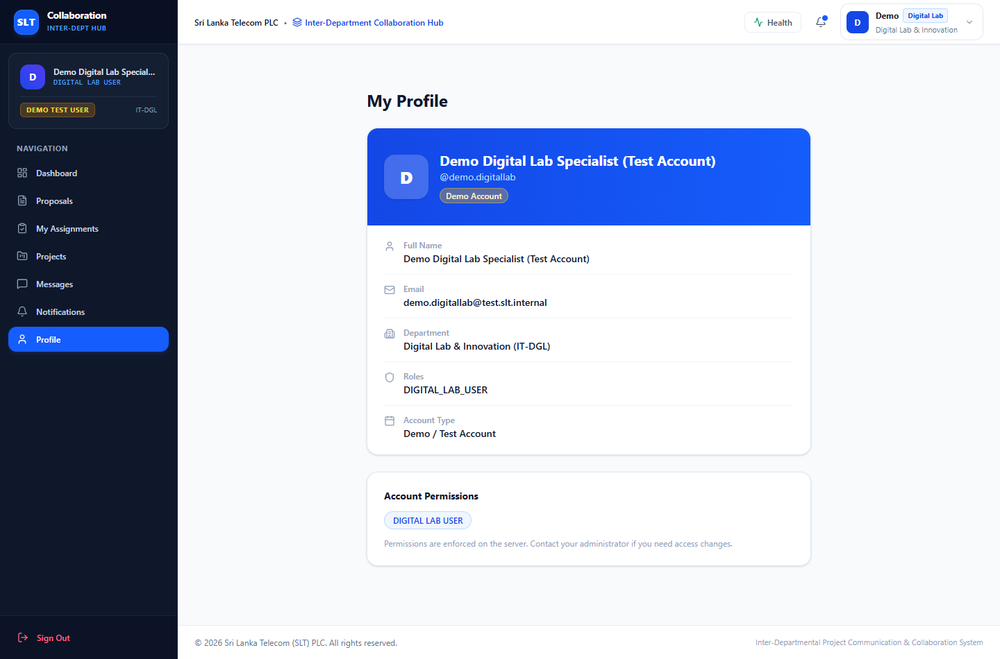

> [!NOTE]
> For security reasons, user profile information is view-only. Personal details, department associations, and role assignments are managed by System Administrators.

---

*End of Document 5: System User Manual.*
